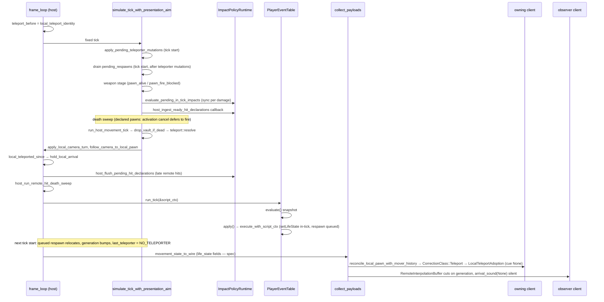

# Player life states — grounding

Read-only grounding for `index.md`. Symbols from five source reads. `[M]` marks a site inferred from adjacent source or precedent; unmarked rows were read. Line counts shown only past ~800.

## Today's behaviour at zero HP

Five predicates decide "dead" today, and they disagree:

- `is_quiescent`: depleted or committed to removal.
- inline `pawn_alive`: exists, not committed, not depleted.
- `player_is_alive_for_trigger_occupancy`: no removal check; a pawn with no Health counts as alive.
- slot-based `player.health` ≤ 0.
- `is_damage_target_eligible`.

The undeclared-pawn path must reproduce each of them exactly.

| Capability | HP ≤ 0 today | Site |
|---|---|---|
| speedScale | Ungated; full speed | movement never reads health (`drop_vault_if_dead` doc) |
| abilities | Jump, dash, crouch, slide allowed. Vault barred, in-progress vault dropped | `drop_vault_if_dead` → `vault_barred`, `break_off_vault` (`is_quiescent`) |
| (teleport) | **Skipped**: `vault_barred` early-returns teleporter resolution | `teleport::resolve` |
| look | Ungated anywhere | `app.camera.rotate` in `frame_loop/mod.rs` |
| fire | Blocked; in-flight activation cancelled; charge HUD hidden | `pawn_alive` in `run_local_weapon_command_inner`, `run_remote_weapon_commands`; `host_activations::binding_is_live`; `sweep_deaths` cancels every sweep; client `predict_with_liveness`, `ClientWeaponFrame::apply_owner_liveness`; `weapon_charge_values` |
| switchWeapon | Ungated | `begin_lower`, `host_switch_timing::apply` / `remote_equip_gate`, `simulate_client_wieldable_tick` |
| reload | Ungated | `tick_weapon_machine_phases`, `advance_predicted_weapon_tick` |
| use | Ungated; Press-mode touchables still claim | `TriggerSystem::run_authoritative_tick_with_dispatch`, `press_claims` |
| touch | Ungated; enters, exits, pickups, drop all work | same fn; `TouchSystem::run_authoritative_tick` |
| occupancy | Excluded from counts; membership and Exit unaffected | `player_is_alive_for_trigger_occupancy` → `effective_occupants` |
| damageable | Splash, projectile direct and hitscan knockback skip it. Local and remote hitscan damage still apply. Remote projectile declarations are refused. AI attack is blocked, but acquisition is not filtered. Contact, crush, impact policy and script `damage` are ungated | `is_damage_target_eligible` (`sim/src/scripting_systems/health.rs`, 933); `selected_target_alive`; `apply_valid_hit_record` |

AC2 pins the teleport skip: a zero-HP undeclared pawn cannot use teleporters today.

## Symbol map per task

### Task 1: thin slice
| Concern | Sites |
|---|---|
| Descriptor field | `EntityTypeDescriptor` fields beside `movement` (`entities/src/data_descriptors/types/entity.rs`). Not a `DescriptorComponentKind`: that list (`entities/src/provenance.rs`) maps every kind to a runtime `ComponentKind` and replication role, and life states have no runtime component |
| Parse | `entity_descriptor_from_js` / `_lua` (`scripting-core/src/data_descriptors/{js,lua}/entity.rs`). Unknown top-level keys are dropped silently today |
| Validator | precedent `validate_charge_interrupts` + `RawChargeInterrupt` (`charge_interrupts.rs`); `DescriptorError::InvalidShape`; called from `staged_manifest.rs` (2588) |
| Struct | `EntityTypeDescriptor` has no `Default`; every literal, mostly test fixtures, gains the new field |
| Name table / payload | `DataRegistry::entities` (kept across level unload by `DataRegistry::clear`); `TuningPayload`, `TUNING_PAYLOAD_EPOCH` (`combat-model/src/carried_loadout.rs`); `tuning_payload_for_pawn`; `payload_json_matches_committed_fixture` (`netcode/src/tuning_payload.rs`, 820) |
| Spawn | `spawn_descriptor_instance` → `attach_descriptor_components` (`data_archetype.rs`, 3408), movement branch beside `ImmersionComponent` [M]; `spawn_from_player_starts_with_carried_loadout`; `spawn_net_slot_pawn_with_carried_loadout` (`net_descriptor.rs`, 3021) via `host_handle_accept_descriptor_at_placement` (`netcode/src/host.rs`, 836) |
| Component / wire | `PlayerMovementComponent.teleport`; `WirePlayerMovementState`, bitcode-derived, `aim_pitch` last (`net/src/wire/components.rs`, 1234); `movement_state_to_wire`, `merge_wire_into_movement_state_checked`, `carry_live_tick_state` (`netcode/src/movement_state.rs`); `WIRE_VERSION` (`net/src/handshake.rs`, 877); `SNAPSHOT_VERSION` (`net/src/wire.rs`, 4278); `collect_payloads` (`netcode/src/replication.rs`, 1313) |
| Fire gate | `pawn_gate::pawn_fire_blocked` is shared by all four lanes, the best seam; `stamp_start_fire_gate`, `guard_initiation`; `binding_is_live` (`postretro/src/host_activations.rs`, 1323); `apply_owner_liveness` (`client_weapon/frame.rs`) |
| Verb | `playerVerbs` (`sdk/lib/data_script/commands.{ts,luau}`); six type declarations: `commands.ts`, `sdk_lib.d.ts` (1268), `data_script.luau` (1083), `sdk_lib.luau` (1851); generated `sdk/types/postretro.d.{ts,luau}` (3233/3662) plus `expected.d.*` fixtures; `validate/consequential.rs`; `CONSEQUENTIAL_PRIMITIVES` (`trigger_bindings/partition.rs`); `bind_command_at` (`command_binding.rs`; unknown primitive → `None`); `BoundTriggerCommand` (`trigger_commands.rs`); `ReactionPrimitiveRegistry::register`; `is_trigger_consequential_primitive`; `validate_group_kind_primitive` (deny-list) |
| Name check | `validate_reaction_bodies_pass_a` (`startup/reaction_validation.rs`, 2467) [M] |
| Condition | `PlayerConditionScope::resolve_input`. Names with `@` are dispatch inputs, so the leaf takes a non-`@` prefix (precedent `ENTITY_STATE_INPUT_PREFIX`) |

### Task 2: movement
`drop_vault_if_dead` (`sim/src/sim/host_movement.rs`) writes `vault_barred` from `is_quiescent`, and `teleport::resolve` skips any pawn with `vault_barred` set. It is called by `run_host_movement_tick` / `run_movement_tick` and the `client_prediction_tick` path (`netcode/src/lib.rs`, 8001). Replay has no registry: `replay_with_armed` (`prediction.rs`, 1499), `reconcile.rs` (1665). Stamped-field precedent `vault_barred` is stamped only on forward ticks and carried by `carry_live_tick_state` and `refresh_plan.rs`, so replay runs on the pre-merge value. Crouch eye easing runs tick-side in `crouching_intent`; replay re-runs it, and the presentation offset carries only displacement. Correction classes are chosen by magnitude in `classify_correction` (`prediction.rs`). The speeds have no single accessor: `normal::intent`, `crouching`, `dash.rs`, `slide.rs`, air cap. Ability entry: `derive_jump_edges`, `try_enter_dash`, `crouch_intent`, `apply_vault_entry` (`physics/src/movement/mod.rs`, 6607). Eye: `capsule.eye_height` via `resize_capsule`; consumed by `attacker_eye`, remote fire origin, AI LOS. Look: `app.camera.rotate` (`frame_loop/mod.rs`, 2789). The host takes `facing_yaw` / `aim_pitch` verbatim, so a host-side look lock is new [M].

### Task 3: interaction and combat
| Key | Sites |
|---|---|
| switchWeapon | `begin_lower` (`commands/local.rs`); `host_switch_timing::apply`, `remote_equip_gate`; `run_client_weapon_equip`. Refusal must use the switch-verdict lane |
| reload | `tick_weapon_machine_phases` (`machine.rs`); remote `reload_refused`; `advance_predicted_weapon_tick`, where `fresh_reload` cancels even when no reload starts |
| use | `use_edges` in `simulate_tick_with_presentation_aim` (`sim/mod.rs`, 4479); `TriggerSystem` (`trigger_system.rs`, 2517) |
| touch | Touch branch there; `TouchSystem` (`touch.rs`, 2967); `canonical_player_capsules`. Removing a pawn from membership produces spurious Exits |
| occupancy | `player_is_alive_for_trigger_occupancy` |
| damageable | `is_damage_target_eligible`, which has only a registry; `SimAiHost::is_quiescent`, read by `ai/src/apply.rs` for the post-damage invalidation and the weapon-aim recheck; hitscan knockback in `apply_weapon_impact_damage_with_source` (`weapon_stage/impact.rs`) reads `is_damage_target_eligible`; remote projectile hit validation (`netcode/src/lib.rs`). `sweep_deaths` uses PlayerMovement presence to tell players apart |

### Task 4: reads and remap
`engine_state_catalog.rs` (1972); `PlayerSlot::ALL` / `player_slot_value_with` (`player_slots.rs`), whose lookup takes no tick; `owner_private_source_value` → `pawn_component_slot_for_pawn` (`state_slots.rs`, 5197); `publish_swim_values` (`ui_proxy.rs`, 2292), which a connected client never reaches: `tick_for_role_and_report_sampled_weapon` returns after `publish_local_weapon_state`; UI display seam `build_ui_display_slot_snapshot` (`main.rs`) with `apply_timed_slot_targets`, reached from `frame_loop/mod.rs` through `App::build_ui_read_snapshot`, a stateless associated function; `MIRRORED_GAME_STATE_LEAVES` (`light_membership.rs`, 3199); `StoreScope` (`ir/scopes.rs`, 1521), which resolves only slot-table names, with the u16 cap assert beside `warned_owned_engine`. There are 14 slots today. The refresh planner `plan_descriptor_refresh` → `plan_movement_replace` (`refresh_plan.rs`, 2299) only reads the registry: it rebuilds a replaced component and resets unlisted fields, and plans nothing for a kept-old or skipped one. `apply_descriptor_refresh_plan` writes only replacements and removals. `ScriptRuntime::commit_staged_manifest_result` (`runtime/core.rs`, 2301) plans, applies, then calls `replace_entity_types`, which `install_deferred_mesh_descriptors` also calls at level install; the commit runs on every role. The remap is therefore its own pass around `replace_entity_types`. `TuningPayload::same_pawn_tuning` compares only `movement` and `wieldables` today.

### Task 5: respawn
| Concern | Sites |
|---|---|
| Queue | `ScriptCtx::pending_teleporter_mutations` (`entities/src/ctx.rs`), an `(EntityId, bool)` arm queue → `apply_pending_teleporter_mutations` (`sim/src/teleporter_commands.rs`) at tick start, gated by `group_commands_apply_here`; level unload clears it (`startup/lifecycle_net.rs`). Precedent `Trap { request }`. Remote facings resolve before the tick (`host_resolve_remote_commands`); a `TeleportEvent` turns them by `yaw_delta` in-tick |
| Placement | `SeatTable` (`netcode/src/seat.rs`, 2104): private placement assignment behind public `assign_joiner_placement`; `bind_pawn` writes seat 0's install placement directly; no getter. `Session::seat_table`; `authority_seat_table_or_local_only`; `bind_installed_first_player` (`startup/lifecycle.rs`, 5342); `App::host_spawn_points` (`main.rs`, 12714); `standing_position`, `first_player_spawn_order` (`player_spawn.rs`) |
| Overlap | `capsule_fits_combined` covers static geometry and movers. No pawn-vs-pawn query exists |
| Relocation | `TeleportState` (`foundation/src/movement/teleport.rs`), `NO_TELEPORTER`, `wrap_teleport_yaw`; private `settle_arrival_ground`. Only `teleport::resolve` bumps today [M for reuse] |
| Health | `set_health_absolute` (via `grant::grant_health`) |

### Task 6: rejoin
| Concern | Sites |
|---|---|
| Harvest | `host_handle_lifecycle` routes `SlotEvent::Closed` and `Demoted` through `host_handle_transport_disconnect`, which harvests before despawn; neither holds descriptors or a table. `harvest_bound_pawns` runs on suspend and level unload; `clear_pawn_bindings_for_level_unload` runs only at unload |
| Suspend | Suspend harvests bound pawns, then `clear_net_level_parity` clears parity and the host's reveal, so every participating slot demotes at the first poll after resume |
| First command | A rejoined remote seat's command queue starts empty; `resolve_tick` returns `None` until its stream begins, and host movement steps only resolved inputs |

### Task 7: consumer, tests, docs
`content/dev/scripts/player.ts` has no Luau twin. Twin precedent: `player-events.{ts,luau}` + `*_surface_tests.rs`. Other content: `combat-lifecycle.ts` (`enemyDeath`, override eviction by id); `hud.ts` `reloadMeterTree`; `start-script.ts`. Test harness: `player_events::tests::World`. `semantics_tests.rs` (802) is at the size flag, so new cases go in a sibling file. `observability/driver.rs` runs no player events. `docs/scripting-reference.md` (4598).

## Grounding for `E18--player-revive-assist`

Kept for the sibling spec; this spec builds none of it.

### Impact policy
`ImpactPolicyRuntime::rebuild` → `bind_policy` → `bind_effect`, `require_impact_token`, `BoundEffect`, `plan_effect`, `apply_planned`, `evaluate_dispatch` (`sim/src/impact_policy.rs`, 4138); `ImpactEffect`, registry-only `apply_effect` (`impact_effects.rs`, 819); `EntityScope::resolve_owned_input`, `seed_owner_seat_from_registry` (`ir/scopes.rs`); `is_player_pawn`; `SourceHandle`, `sourceImpactEffect`, `ImpactEffectWire` (`data_script.{ts,luau}`); `ir/parity_tests.rs` (2017). Whether a descriptor reload re-runs `rebuild` is unverified [M].

### Assist
`WireMovementInput.use_pressed` is an edge: `PressEdges`, `held_gap_sim_command` (`command_queue.rs`, 2803). `BoundPlayerEvent`, `BoundAddresses` and `bind_event` (`player_events/install.rs`) assume edges. `player_event_from_json` requires `condition`. `PlayerEventTable::run_tick` → `evaluate` / `apply` (`player_events/mod.rs`). Precedent `scheduler.evaluate(&tick_events.trigger_exit_fires)`. `fire_list_violation` (`validate.rs`) takes no source kind [M].

## Life-state lifecycle

```mermaid
stateDiagram-v2
    [*] --> Initial: spawn / level change / restartLevel / rejoin with no rejoin entry<br/>(level unload clears the carried name; a rejoin with an entry enters rejoin[S], AC14)
    [*] --> Named: rejoin with a rejoin[S] entry (elapsed := 0)
    Initial --> Named: setLifeState(name) (in-tick verb)
    Named --> Named2: setLifeState(other)<br/>elapsed := 0
    Named --> Named: setLifeState(same) — no-op, elapsed continues
    Named --> Initial: respawn() (next tick relocation)
    Named --> Named2: respawn({ lifeState })
    Named --> Initial: hot reload, name removed (one warning)
    Named --> Named: hot reload, name kept (elapsed continues, restamped)
    Named --> Named: health ≤ 0 — NO transition<br/>(death sweep only, playerDied latch unchanged)
    Named --> [*]: disconnect / demotion / level unload (harvest by name)
    state "current state (named)" as Named
    state "another named state" as Named2
    state "descriptor initial" as Initial
```

## One host frame

## Vantages

| Vantage | State entry | Gate evaluation | `lifeStateMs` | Respawn |
|---|---|---|---|---|
| Host-local player | In-tick verb on host registry | Component stamps, restamped from the lowered descriptor block | Component field; UI display adds alpha × step | Tick-start drain before camera callback, so `hold_local_arrival` snaps for free |
| Single player | Same as host. No endpoint, no `server_tick` | Same | Same; no wire | Same. `SeatTable` is `Some` (`local_only` fallback); the headless driver may have none, so it falls back to `first_player_spawn_order` |
| Client, own pawn | Movement state merged, then restamped, before replay; kept when the record's revision has no installed table | Stamps restamped from the `TuningPayload` table matching the component's revision, never local descriptors. Fire at `apply_owner_liveness` | Store: owner-private slot at about 30 Hz (`SNAPSHOT_TICK_INTERVAL`=2). UI: predicted elapsed + alpha × step, held monotonic | Generation mismatch → Teleport class; the yaw stamp keeps in-flight input valid |
| Observer client | Remote movement state | None runs; the host is authoritative | Not exposed (owner-private) | Interpolation cut, silent |
| Late joiner | `FullBaseline` carries every payload; own pawn spawns in `initial` | Needs `TuningPayload`. A tuning epoch mismatch means no prediction, but no handshake fails | Baseline value | n/a |

Divergence source: only the host runs transitions. Clients diverge only in sampling rate and in a one-correction window at a host transition (O9, O13).

## Findings against other drafts and docs

- **`coop--spawn-placement-occupancy` premise refuted.** Since `0d0aa24`, `spawn_from_player_starts_with_carried_loadout` returns after one spawn and `capture_player_spawn_placements` is gone. Seat tests `joiners_take_the_spawns_the_host_pawn_leaves_free` and `the_first_joiner_after_a_level_change_takes_the_first_free_spawn` pin first-free selection.
- **`docs/scripting-reference.md` stale claims:**
  - "`perOwner: true` with `persist: true` is rejected" is false. `store_bridge.rs` accepts it, and dev `progression.xp` uses it.
  - "No source-scoped fact vocabulary" is false. `byPlayer(impact.source)` reads exist. The same stale line sits in the `SourceHandle` doc comments in `data_script.ts`.
  - "Every operand reads the same starting value" is false for owner-addressed reads. `read_owned_store` reads live.
- **Debug-mirror drift.** `is_trigger_consequential_primitive` lists `applyDamage`/`addSlot` but not `grantHealth`/`grantAmmo`. Fix it in Task 1 alongside `setLifeState`.
- **`player-descriptor-composition` needs a rebase.** Its Task 1 split shipped; its states-axis, modifiers-under-states and layered viewFeel are unbuilt, and its baseline predates friction, vault, swim and viewPose. No key collision: its states live inside `components.movement`.
- **Already-true behaviour the spec relies on.** `restore_carried_health` skips carried HP ≤ 0, tested by `nonpositive_carried_health_keeps_descriptor_default`. `harvest_pawn` also runs at level change, on slot demotion and on suspend, which grounds O7, O22 and O23.
- **Slot cap.** 14 slots today, so the spec's 15 fits u16 with one to spare. Any per-player slot past 16 must widen the bitset to u32.

## Review round 2 decisions

- **`abilities` has its own stamp.** Reusing `vault_barred` would also bar teleporters, since `teleport::resolve` skips a barred pawn. For declared pawns `vault_barred` derives from the `abilities` stamp, and teleporter entry follows `touch`: a teleporter is a volume the pawn walks into.
- **Gates read component stamps.** Most gate sites hold only `&EntityRegistry`; `DataRegistry` lives on `ScriptCtx`. Stamping the profile at every `life_state` write reaches every site with no new plumbing, on every role.
- **The client merge stays a plain copy.** `carry_live_tick_state` merges through the same function, so a gate inside it would drop the live state at every tuning rebuild. The gate runs in the reconcile and rebuild callers.
- **Elapsed counts host ticks, not movement steps.** A rejoined remote pawn takes no movement step until its first command, so a step-based count would read 0 for its first passes.
- **`look: false` freezes at input sampling.** A host-side clamp of a remote pawn's facing would disagree with the camera the client kept turning before the state arrived, forcing a snap.
