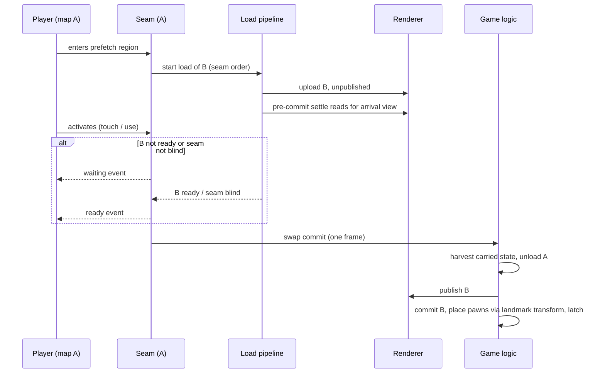

# Epic 25 — Map Transitions: research

Read at `05c5491`. Findings from the drafting session, cited by symbol.

## 1. What exists

- **Trigger-driven level change works today.** A `trigger_volume` (touch or use) or `switch` names a reaction in `on_fire`; that reaction can be `loadLevel(id)`. `trigger_bindings/partition.rs` classifies `loadLevel`, `restartLevel` and `returnToFrontend` as `LIFECYCLE_PRIMITIVES`, which ride the residual step list; `drain_frame_residuals` (`sim/src/residual_drain.rs`) sends them to the system reaction registry, which pushes `SystemReactionCommand::LoadLevel`. No content or test exercises it from a trigger.
- **Use key.** `Command::Use` → `Action::Use`, default E and gamepad West (`input/defaults.rs`); presses become `trigger_use_edges` for the trigger tick.
- **Load order.** `drain_level_requests` (`startup/lifecycle_boot_state.rs`) runs `unload_level`, then `begin_level_load`. A request during a CLI boot load is dropped with a warning; a newer load replaces a queued one.
- **Carried state.** `CarriedState` (`combat-model/src/carried_loadout.rs`): `health_current`, `reserve`, `wieldables`, `magazines`, `active_slot`. Stored in `SeatTable.carried`, harvested by `SeatTable::harvest_bound_pawns` inside `unload_level`, re-applied at spawn (`spawn_from_player_starts_with_carried_loadout`, `spawn_net_slot_pawn_with_carried_loadout`). No armor, heat or cell state; no pose.
- **Arrival.** Always player starts: `first_player_spawn_order` single-player; in co-op, `assign_joiner_placement` picks a client pawn's spawn at participation entry, not at install (install spawns only the host's pawn).
- **No revisit persistence.** Every load is fresh; only mod slots and per-seat carried state survive.
- **Co-op relevel.** Host sends `ServerControlMessage::Relevel` at install; clients run `follow_relevel_catalog`; slots demote through the participation predicate, re-reveal after Settling, and respawn with carried state.
- **Load cost.** `run_worker` (`startup/worker.rs`) does only the PRL parse. `install_level_payload` runs collision, textures, geometry, the glTF parse and upload, and sounds on the main thread in one frame. `install_level_geometry` rebuilds compose and cull pipelines per load and per unload; `MeshPass::release_level_resources` clears every model. `ready/level-load-pipeline/research.md` §2.1 measured the install at ~0.7–1.0 s on lavapipe.
- **Already delivered by `sh-streaming--reveal-gate-and-warm-horizon`.** The spawn lightmap is a Settling target (`startup/settling.rs`; `ResourceSettle` in `session/level_streaming/settle.rs`); the loading tree draws through Settling; the bar reaches 1.0 at reveal. The 0.85 parse cap remains.
- **Streaming scope.** Only baked SH (ids 49/50) and lightmap/shadowmask cell blocks (ids 22/42/51) stream, inside one PRL. Everything else loads whole.

## 2. Precedents

- **Seamless teleport.** One pure `foundation` function maps a pose through landmark → target; ghost links share it (`movement.md` §6, `entity_model.md` §7d). Within one PRL, room copies already join through seamless teleporters.
- **Arrival latch.** Teleporter arrival latches the pawn against every armed teleporter containing its body point.
- **Doors as occluders.** Baked per-mover sealed portals; runtime blocks them while `mover_is_docked_closed`.
- **Visible-set superset.** `rendering_pipeline.md` §2: the walk may over-include, never under-include. Fallback paths are supersets except near-slab and clip-pad slivers.
- **Ghost links draw entities only**, never world geometry: no precedent for drawing another level's world.
- **Light presentation.** `setLightAnimation` is a reaction primitive; host light changes replicate.

## 3. Swap lifecycle

## 4. Rejected shapes

- **Metroid Prime door-press load** — the hesitation itself; kept as fallback.
- **One campaign-sized PRL** — whole-campaign compiles; streaming covers baked light only.
- **Compile-time-only blind cells** — door state is runtime.
- **Per-camera frustum blind check** — depends on each client's view, which the host does not hold exactly; the all-directions check from the eye does not.
- **Separate seamless pipeline** — duplicates install order, failure, cancellation and parity.
