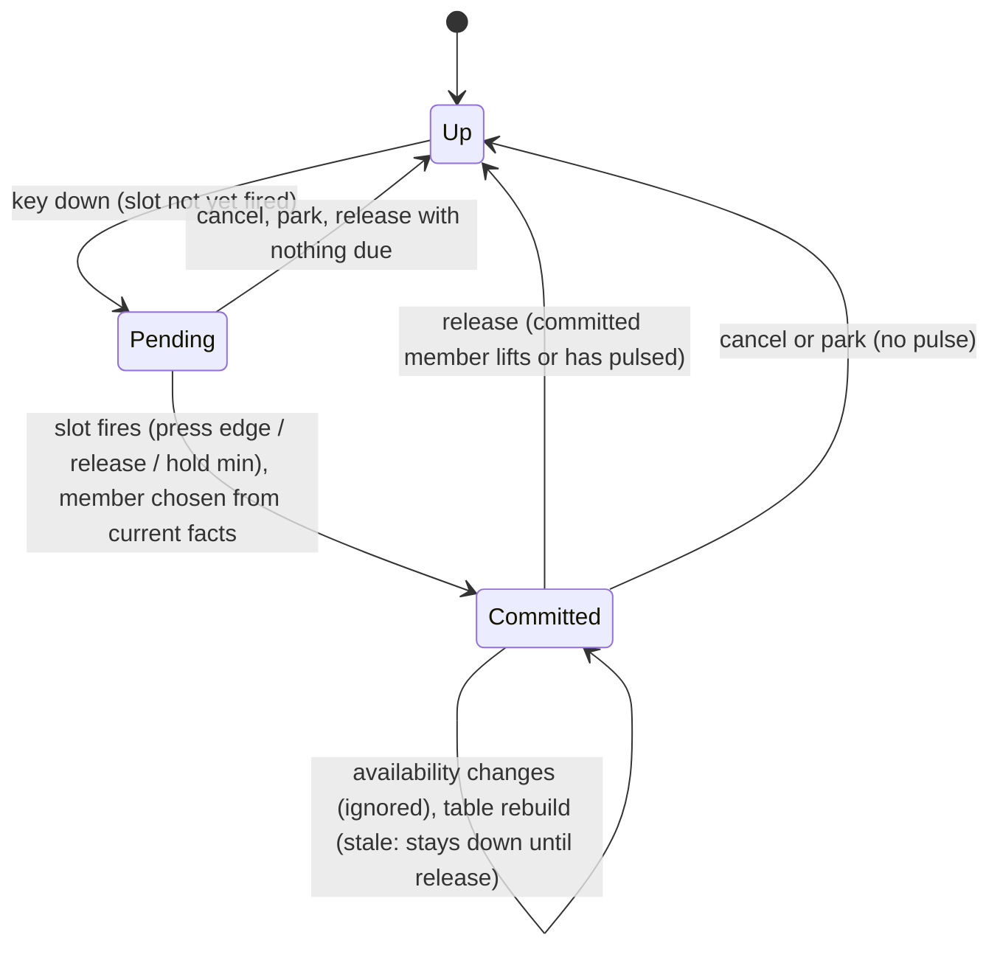

# Input Contextual Priority — Research

Supporting notes for `index.md`. Decisions live there; this file holds the grounding, the precedent survey, and the lifecycle diagram they came from.

Read at: `916db71`.

## Draft-session handoff

```markdown
Problem: Two gameplay commands bound to one key in one context conflict and the later is unbound, so assist cannot default to Use's key, and no shared key can resolve by what is currently possible.
Outcome: Interaction commands may share a key; each press drives the highest-ranked available one, committed until release; combat commands never resolve by availability; the HUD can show what a press will do; a client resolves locally and sends the resolved command.
Read at: 916db71
Verified facts: see §Grounding.
Not verified: revive spec's assist step and Spec A's capability helper (not built; read from their drafts).
Decisions: see index.md Direction.
Non-goals: see index.md Out of scope.
Proof: see index.md Acceptance criteria and Orderings.
Open owner questions: see index.md Open questions.
Route: spec
Why this route: modder-facing contract (input block semantics, a new HUD slot), a player-facing rule change in the conflict checker, and a cross-spec dependency with E18--player-revive-assist whose task boundary must be owner-reviewed.
Next action: draft
```

## Grounding

Every symbol below was opened at `916db71`.

### Binding table and conflicts — `crates/postretro/src/input/binding_table.rs` (617 lines)

- `conflicts(a, b)` is the single conflict predicate. Same input, different commands, a shared `LiveContext`, then: menu/cancel exempt; cross-context (UI vs gameplay) always conflict; same context conflicts unless exactly one is `hold` and neither is press-only (`press_only` = refuses `ActivatorKind::Hold`). So two short gameplay bindings on one input always conflict today.
- `collides(kept, candidate)` = `conflicts` plus a lower layer's `hold` landing on a player's short binding.
- `EffectiveTable::build` → `layer_command` per command/class → `resolve_collisions` (higher origin first, then manifest order) → `restore_guard`. A loser goes to `suppressed`; a player-held winner flags `displaced`.
- `EffectiveTable::gameplay_bindings` turns entries into input-system `Binding`s through `defaults::gameplay_binding`.
- `engine_slots` gives every engine default `Activator::PRESS`.

Consequence: a group exemption inside `conflicts` reaches every consumer that already calls it — `resolve_collisions`, `restore_guard` (via `collides`), `rebind::holders_of` (rebind proposals), `author_layer::report_collisions` (via `validation_table`), and the test-only `conflicting_pairs`.

### Commands — `crates/postretro/src/input/commands.rs` (452 lines)

- `Command` is engine-closed; every property is an exhaustive match (`context`, `kind`, `accepts`, `gameplay_target`).
- `Command::accepts`: shoot/alt-fire/analog/wheel → `press` only; sprint/crouch/movement → `press`|`hold`; everything else (use, reload, drop, jump, dash, selections) any kind.
- `gameplay_target` maps a command to `(Action, sign)`; `Action` lives in `input/types.rs`.
- `assist` does not exist yet; `E18--player-revive-assist` Task 2 adds it to "the closed gameplay action set" accepting `press` or `hold`.

### Engine defaults — `crates/postretro/src/input/defaults.rs`

- `engine_default_inputs`: `Use` = `KeyE` / `GilrsButton::West`; `Reload` = `KeyR` / `North`; `Jump` = `Space` / `South`; `Dash` = `KeyF` / `East`. All four face buttons are taken by gameplay commands, so a dedicated gamepad default for `assist` would have to take a shoulder, stick press or D-pad input already in use (D-pad up/down are dev-only fly-cam; left/right cycle weapons; `LeftTrigger` is toggle-last-wieldable; `Select` is drop).

### Activator resolution — `crates/postretro/src/input/activator.rs` (372 lines)

- `ActivatorResolver` keeps `held: HashMap<PhysicalInput, HeldInput>`, per-binding `binding_down`, per-action `command_down`, per-frame `went_down`.
- `input_down`: on press, every `press` binding on the input goes down unless the input `shares_hold` (then only level-reading movement bindings go down).
- `input_up`: shared input fires the short partner by `pulse` if the hold has not fired; `tap` within its max.
- `advance`: fires holds whose min elapsed (`hold_threshold_passed` is strict, so a release at exactly the min goes to the short partner).
- `cancel_all` (focus loss, capturing tree): lifts everything without a pulse, suppresses held inputs until seen up.
- `park_gamepad`: pad switch/disconnect, same no-pulse rule.
- `rebind`: unchanged bindings keep resolving; a changed input goes `stale` — what is down stays down until release, nothing new fires.

### Input system — `crates/postretro/src/input/system.rs` (815 lines)

- Edges are buffered in `pending_edges` and fed to the resolver in time order by `resolve_pending_edges`, which `snapshot_at` calls at the start of each frame's Input stage. So every edge resolves inside `snapshot()`, never at OS-event time.
- `set_hold_timing_scale` is the precedent for a per-frame/per-option value the App pushes in; a press keeps the scale it went down with (`HeldInput.scale`).
- File is past 800 lines; the plan adds one setter and a pass-through, no logic.

### Relevance — `crates/postretro/src/input/relevance.rs`

- `RelevanceFacts` is a small fact struct the App derives "from the entity registry ... so the input module stays free of registry types". `derived_relevance` is an exhaustive match. This is the precedent for passing availability into input as a fact struct.

### Glyphs — `crates/postretro/src/input/glyphs.rs`

- `resolve_glyph` draws the command's first effective binding on the family's class; irrelevant/unbound draws nothing. Grouped members both keep their table entries (no collision), so `Glyph({command:"assist"})` and `Glyph({command:"use"})` both draw E with no change.

### Rebind and panel

- `rebind::propose_rebind` asks `holders_of`, which filters on `conflicts`. A capture onto a group partner's input therefore proposes `Clean` once `conflicts` exempts the pair.
- `app/controls_panel.rs` (996 lines): `controls_rows` builds per-binding `(input, activator kind)`; `row_cells` formats `input_label + activator_suffix`. The displaced note is the precedent for a conditional note line.

### Author layer — `crates/postretro/src/input/author_layer.rs`

- `author_layer_from_block` validates per command/class; `diagnose_tap_past_hold` and `diagnose_guard` then `report_collisions` (logs `conflicts with … is unbound there` for every author-origin loser). `ModInputBlock` / `ModInputCommand` in `crates/scripting-core/src/runtime/input_block.rs` carry `label`, `category`, `order`, `show`, per-class binding lists, glyph dirs. No priority field exists.

### Frame loop and sim command — `crates/postretro/src/frame_loop/mod.rs` (2789 lines), `crates/postretro/src/main.rs`

- `use_pressed = tick_index == 0 && snapshot.button(Action::Use) == Pressed`; drives `trigger_use_edges` for `followed_player_pawn` and `build_sim_command`.
- `build_sim_command` (main.rs) builds `SimCommand` from the `ActionSnapshot`: `use_pressed` edge, `reload` level, etc. Revive Task 2 threads `assist_held` here.
- `App::is_connected_client` selects the client prediction branch.

### Wire and host queue

- `WireMovementInput` (`crates/net/src/wire.rs`) carries `use_pressed: bool` (an edge); revive appends `assist_held`. `InputCommand` carries movement, fire, reload, secondary, activation. No raw-key field exists; the wire carries resolved intent (`input.md` §Activators).
- `crates/netcode/src/command_queue/press_edges.rs`: use and drop presses are retained edges observed at intake, delivered once on an advancing resolution. `command_queue::held_gap_sim_command` clears `use_pressed` on a held gap; held levels ride the hold-then-neutral policy (`INPUT_HOLD_TICKS` = 3). A held `assist_held` level therefore rides gaps; a Use edge is never re-synthesized.
- `crates/netcode/src/host_input.rs` routes `InputCommand`s into per-client queues; the host never sees a physical input for a remote pawn.

### Slots

- `input.mode` is an `EngineStateCatalogEntry` (`crates/entities/src/engine_state_catalog.rs`): `EngineStateValueType::Enum { values: INPUT_MODE_VALUES }`, `Readonly`, `ReplicationScope::None`, written app-side by `scripting/frame_systems/input_mode.rs` through `write_store_slot`. Precedent for an app-written, client-local, readonly enum slot.

### Sibling drafts

- `E18--player-revive-assist`: AC7 (assist on a dedicated key, no dependency), AC8 (shared key default — the dependency), I4 (one press performs exactly one of `assist`/`use`, resolved on the client; host never converts), Task 2 "Shared-key default" bullet (availability = the client's predicted step reporting a candidate; single-player reads the authoritative accumulator; client sends only the resolved command), Phase 3 (shared-key default lands after this spec).
- `E18--player-life-states`: `player_capability(state_or_component, Capability)` — the one capability helper; a helper whose state has `use: false` cannot assist (revive AC5) and cannot Use (Spec A AC4).

## Precedent survey

How co-op shooters put several context actions on one button, and how they keep the wrong one from firing in combat.

| Game | Shared button | How it resolves | Lesson |
|---|---|---|---|
| Halo 3 (default 360 layout) | RB: reload right gun; hold RB: pick up weapon to right hand | Duration: tap vs hold | Combat action on the tap, opportunistic pickup behind a deliberate hold |
| PUBG (Xbox scheme) | X: hold to reload, tap to interact | Duration | Same split, opposite assignment — duration is the arbiter, either way round |
| Apex Legends (controller) | Square/X: reload, interact (doors, loot, revive, finisher, Caustic traps) | Availability: interact wins when in reach; settings add tap/hold split and a priority flip | The documented failure class. Players "forced into a revive or finisher when they only want to reload", door and own-trap pickups stealing reloads. Respawn acknowledged it and called the door case harder than revive |
| Destiny 2 (controller) | Reload/Interact on one face button | Short press reloads; interactions are holds | Combat on the short press |
| Back 4 Blood | Reload/Interact on X/Square | Revive requires holding interact; a tap does nothing | Revive is a sustained hold on the interact key |
| Left 4 Dead 2 (PC) | `+use` on E: use, take weapons, open doors, revive (hold) | Availability by what you face/stand near; revive is a hold | Revive and use share the key; both are interactions |
| Darktide / Vermintide 2 | Hold E revive; E interact/pickup | Availability, prompt-driven | Same shape as L4D; complaints are about revive interruption, not key theft |
| Deep Rock Galactic | E use, R reload | Separate keys on PC | Keyboard has room; the conflict is a controller problem |
| Helldivers 2 | E interact (hold), R reload; long-press R weapon wheel | Separate keys; interact offers tap/double-tap/press/hold/long-hold modes | Player-chosen activation mode for the interaction key |
| Remnant 2 (controller) | X: interact / item 1 | Not rebindable on controller | — |
| Enshrouded | Pickup on the interact key | Pickup prompt live everywhere around the base | Owner's report: the action key picked up an item mid-combat where a combat action was expected. Public threads found complain of the same opportunism around the base (accidental pickups and deletions) and ask for pickup only while the build hammer is equipped — i.e. scope the opportunistic action to a mode |
| Path of Exile (controller) | X: interact and a bound skill | With enemies near, auto-targeting makes X cast the skill instead of interacting | The inverse steal; fix is never to share a combat skill with interact |
| Minecraft (console) | Attack/use with drops on the ground | Attacks turning into pickups mid-fight | Same failure class |
| Steam Input | Action sets and layers | One active set per device; layers stack and override; switch on discrete game-state changes | Context is explicit and changes on state transitions, not by per-frame opportunism |

### Patterns

1. **Duration split.** A combat action on the short press and an opportunistic action behind a hold (Halo 3, Destiny 2, PUBG, Apex's optional setting). Deterministic: the player's own input decides, never world state. PostRetro already has this as the Steam rule (`input.md` §Shared keys).
2. **Availability priority between interactions.** Revive and use share the key; the urgent one (revive) wins when possible and is a sustained hold with a prompt (L4D2, B4B, Darktide). Works because neither action is a combat action and the prompt says which one is live.
3. **Availability priority between a combat action and an interaction fails.** Apex's reload-vs-interact on controller is the reference failure: any frame something interactable is in reach, the combat button stops doing the combat thing. Players asked for reload priority or a tap/hold split. Enshrouded, Path of Exile and Minecraft show the same class.
4. **Commit, don't re-resolve.** None of the working precedents switch a held press from one action to another mid-hold; an L4D revive in progress stays a revive. Re-resolving each tick is what lets a newly available action steal a press already underway.
5. **Show the current meaning.** Every working precedent shows a prompt for the opportunistic action at the moment it is available. An ambiguous key is safe only when its meaning is visible.
6. **Scope opportunistic actions to a mode** (Enshrouded threads, Steam Input sets). Out of reach for this spec's two commands, but it is why combat commands are excluded rather than ranked.

What shaped the spec most: pattern 3 (Apex). It is why groups admit interaction commands only, why reload stays on the duration rule, and why the spec commits at press.

### Sources

- Halo 3 controls: [Halopedia H3 control schemes](https://halopedia.org/H3:Control_schemes), [Prima Halo 3 eGuide](https://primagames.com/eguides/halo-3-eguide/essentials)
- PUBG Xbox scheme: [Xbox Wire, PUBG control scheme](https://news.xbox.com/en-us/2017/12/10/xbox-control-scheme-playerunknowns-battlegrounds/)
- Apex reload/interact: [Charlie Intel, dev addresses reload/revive controller restrictions](https://charlieintel.com/apex-legends-dev-reload-revive-controller-restriction/145646), [EA forums, reloading near interactive objects](https://forums.ea.com/discussions/apex-legends-feedback-en/reloading-while-near-interactive-objects/8472434), [EA forums, reloading prioritised over reviving](https://forums.ea.com/discussions/apex-legends-feedback-en/issue-reloading-prioritised-over-reviving-on-controller/8687033), [mein-mmo on the console control element](https://mein-mmo.de/en/a-control-element-of-apex-legends-annoys-players-on-xbox-one-and-ps4-severely,340139), [Automaton (JP)](https://automaton-media.com/articles/newsjp/20211105-181386/)
- Destiny 2 controls: [gamepressure Xbox One controls](https://www.gamepressure.com/destiny-2/xbox-one-controls/z2e4c6)
- Back 4 Blood: [Shacknews controls](https://www.shacknews.com/article/126052/back-4-blood-controls-and-keybindings), [Sportskeeda revive guide](https://www.sportskeeda.com/esports/how-revive-teammates-back-4-blood)
- Left 4 Dead 2 binds: [Steam discussion](https://steamcommunity.com/app/550/discussions/0/1746720717334727574)
- Darktide revive: [Fatshark forums, gripes about reviving](https://forums.fatsharkgames.com/t/gripes-about-reviving/76361), [Fatshark forums, hold E failure](https://forums.fatsharkgames.com/t/hold-e-failure/67986)
- Deep Rock Galactic controls: [gamepressure](https://www.gamepressure.com/deep-rock-galactic/controls-pc-xone-and-xsxs/zcd42b)
- Helldivers 2: [wiki combat](https://helldivers.wiki.gg/wiki/Combat), [Steam discussion on interact modes](https://steamcommunity.com/app/553850/discussions/0/4206994023682263092)
- Remnant 2: [Fextralife controls](https://remnant2.wiki.fextralife.com/Controls)
- Enshrouded pickup prompts: [Steam discussion](https://steamcommunity.com/app/1203620/discussions/0/7599331177369738987), [Steam discussion](https://steamcommunity.com/app/1203620/discussions/0/4339851480048153809)
- Path of Exile: [controller pickup/interact in combat](https://www.pathofexile.com/forum/view-thread/3602014)
- Minecraft: [feedback thread](https://feedback.minecraft.net/hc/en-us/community/posts/360067285191/comments/360014044611)
- Steam Input: [Action set layers](https://partner.steamgames.com/doc/features/steam_controller/action_set_layers), [Concepts](https://partner.steamgames.com/doc/features/steam_controller/concepts)

Coverage gaps: no primary source was reachable for Borderlands 2/3, Payday 3 or Valheim key handling; searches returned guides for other games. The Enshrouded combat case rests on the owner's report; public threads found cover the base-building variant.

## Lifecycle

One press of a grouped input, keyboard, connected client.

```mermaid
sequenceDiagram
    participant FrameN as Frame N (client)
    participant Avail as App availability
    participant Slot as input.interaction slot
    participant Input as InputSystem (frame N+1 Input stage)
    participant Sim as frame loop / SimCommand
    participant Host as Host queue + assist step
    FrameN->>Avail: after tick loop: predicted candidate query + use capability
    Avail->>Input: set availability facts
    Avail->>Slot: write "assist" | "use"
    Slot-->>FrameN: HUD prompt drawn this frame
    Note over Input: OS key-down buffered in pending_edges
    Input->>Input: snapshot(): resolve edge, choose member, commit on HeldInput
    Input->>Sim: Action::Assist level (or Action::Use Pressed)
    Sim->>Host: InputCommand assist_held=true (or use_pressed edge)
    Host->>Host: assist step: candidate on host? progress : nothing
    Note over Input: key-up: committed member lifts; nothing else fires
```

States of one input carrying a group:



For a `press` group the Pending state lasts zero time: the press edge is the fire moment.

## Vantages

| Vantage | Availability source | Resolver | What the host does |
|---|---|---|---|
| Single player | authoritative assist candidate query + `player_capability(Use)` | local | applies the resolved command |
| Listen host, own pawn | same as single player | local | same |
| Connected client, own pawn | predicted candidate query over interpolated remote pawns, replicated life states, `TuningPayload` profiles | local | applies `use_pressed` or `assist_held` from the wire; its own assist step re-checks the candidate |
| Host, remote pawn | none — the host never resolves a remote key | none | applies what arrived |

The client and single-player rows differ only in the availability source; the resolver and the commit rule are the same code. The host-remote row is the reason no wire change is needed.

## Alternatives considered (detail)

- **Duration split for assist vs use** (assist `hold`, use `tap` on E — legal today under the Steam rule). Every Use in the game would fire on key-up instead of key-down, and a tap beside a downed teammate would still open the door behind them. Revive AC8 needs availability, not duration.
- **Re-resolve every tick** (the key drives whichever member is available this tick). Lets a newly available assist cancel a held Use mid-press, and in the reverse case lets a press that started as an assist fall through to Use when the target drifts out of range. Precedent pattern 4.
- **Host-side resolution** (send a raw "interaction key" level; host picks). Adds a round trip before the player learns what the key did, can disagree with the prompt the player saw, and adds a wire field. `input.md` already places activator resolution client-side for the same reason.
- **Author-declared groups and order in the `input` block.** The command set is engine-closed and availability predicates are engine code, so the one group that exists has one sensible order. Recorded as an open question.
- **A combat lockout** (suppress lower-priority contextual actions for N ms after firing). Needed only if combat commands could group. Excluding them removes the case.
