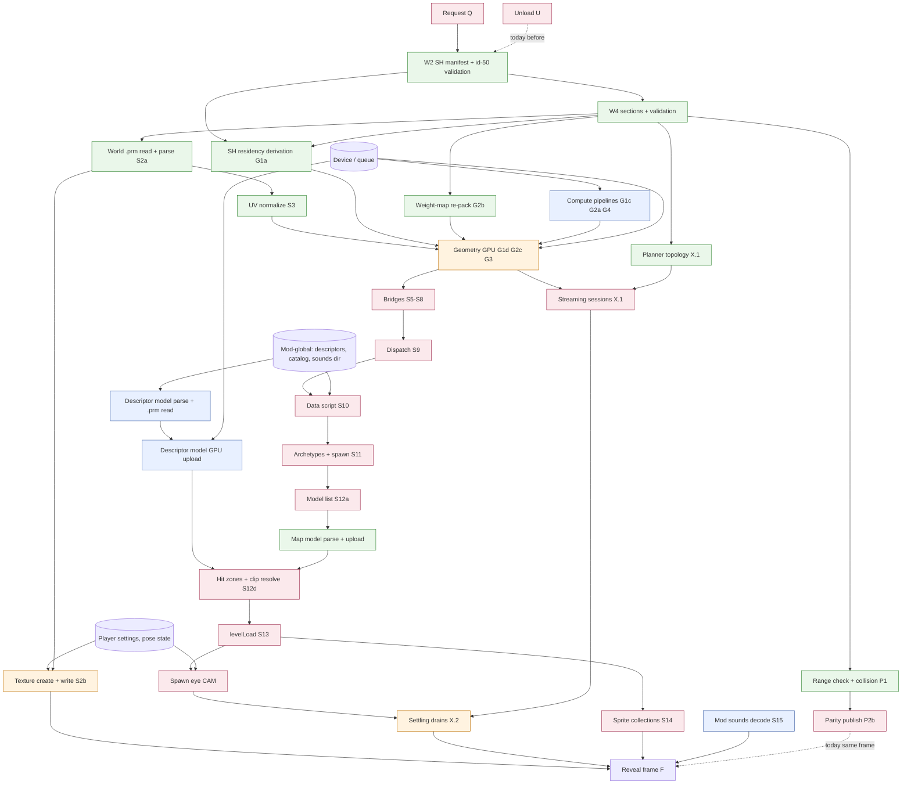

# Level-Load Pipeline — Research

> **Read this when:** drafting the level-loading pipeline spec with the owner. This is its research section: the facts the design is made from. It chooses nothing.
> **Key facts:** at `a2e1f4b` (after the reveal gate) the main thread is idle for the whole parse, then does ≈ 0.63–0.81 s of install in one redraw before Settling (lavapipe). About half of that install is level-invariant; the rest is per-level any-thread CPU and GPU-device work, in proportions that differ by map. Only ≈ 5–20 ms needs the script VM. Settling, not the install, dominates time to reveal here.
> **Related:** `context/lib/boot_sequence.md` §1–§4 · `context/plans/done/level-load-perf/contract.md` · `context/plans/done/level-load-perf/findings.md` · `context/lib/networking.md` §Admission and content parity · `context/lib/rendering_pipeline.md` §12

---

## Sources and labels

Every number carries a label.

| Label | Meaning |
|---|---|
| **m** | Measured at HEAD `a2e1f4b` (2026-10-28). Release profile, this Linux container (4 cores, 15 GB), Mesa 25.2.8 lavapipe under Xvfb 640×480, `--windowed`, launched through `postretro-tool run --install-root .` with the dev mod. One warm-up launch per map, discarded, then 4 launches per map, each a first load from the CLI followed by two same-map level changes: n = 4 first loads and 8 changes, medians, ranges in §2. Parse harness: n = 8 per map. No audio device, so level sounds cost 0. |
| **e** | Estimate: arithmetic on measured numbers, shown. |
| **r** | Code reading at `a2e1f4b` unless a section names another commit. |
| **p** | Perf share from `done/level-load-perf/findings.md` (pre-Track-A). Used only where §1 cites it. |

**Maps.** Both were rebaked for this session, so §2 is not like-for-like with the numbers this file carried before. campaign-test: default warm bake, 330 MB PRL (the findings' was 142 MiB). stress-warren-lit: the warm bake's stage cache outgrew the disk (≈ 24 GB) and failed, so it was baked with `--no-cache --working-set-max-size 11GiB` (exact lighting), 4.36 GB PRL (the findings' was a 1.85 GiB warm bake). Model textures were baked with `postretro-tool bake-model-textures` for every dev glTF.

**Instrumentation.** Line C, `[Renderer] Texture install timing:`, `[Renderer] Geometry install timing:`, `[Startup] unload_level=` and the `[Settling] entry` line, plus temporary marks that were not committed: a timer around every pipeline and shader-module creation, around `ShResidencyState::from_manifest`, `sparse_compose_capacity` and model-texture `.prm` read and parse; per-model parse and upload times; sub-phase marks inside the compose-family install; the install redraw's body; a level-change cycle hook; and the lavapipe storage-binding clamp the findings used. The parse harness is a scratch example calling `load_prl` once per process (the findings' `x_parse_bench` was not retained, so it was rebuilt the same way).

GPU-side cost is not measured anywhere: lavapipe compiles and rasterizes on the CPU. Every renderer-owned number below is a lavapipe CPU number.

Map shorthand: **lit** = stress-warren-lit, **camp** = campaign-test. "F / C" = first load / level change.

---

## 1. Stage inventory

### 1.0 What pins a thread

| Type | Thread property | Evidence (r) |
|---|---|---|
| `LevelPayload` (the worker's output) | `Send` | Compile-time `assert_send::<LevelPayload>()` in the worker module. |
| `Renderer` | Not `Send` | Field `cpu_frame: Rc<StageFrame<RenderStage>>`. §2's "the renderer, which is not `Send`" holds through at least this field; other fields were not audited. |
| Renderer upload queue (`UploadQueue`) | `Send`, not `Sync` | `Cell`/`RefCell` fields (batch, pool, counts). |
| wgpu `Device`, `Queue` | `Clone + Send + Sync` | `static_assertions::assert_impl_all!(Device: Send, Sync)` and the same for `Queue` in wgpu 30.0.1. Both derive `Clone`. |
| `ScriptCtx` | Main thread only | `Rc<RefCell<EntityRegistry>>`, `Rc<RefCell<DataRegistry>>`, `Rc<RefCell<SlotTable>>`, `Rc<Cell<f32>>` gravity. `Session` owns it, so `Session` is pinned too. |
| `ScriptRuntime` (QuickJS, Luau) | Main thread only | Session-owned; primitives capture `ScriptCtx` clones. |
| `LoadedModel` (glTF parse) | Plain data | No `Rc`/`RefCell` in `postretro-model` types. Not asserted. |
| `HitZoneStore` | `Send`, not `Sync` | `RefCell` warning sets. Session-owned. |
| `ShStreamManifest` | `Send + Sync` | Already shared by `Arc` with SH worker threads. |

So "renderer-owned" work can leave the main thread only through device/queue clones held outside `Renderer`, with results handed back into renderer state on the main thread. Anything reading the entity or data registry is main-thread only.

Affinity codes used below: **Any** (plain data), **R** (needs device/queue), **M** (main thread: script VM, `ScriptCtx`, session state).

Input codes: **L** level file (payload) · **G** mod-global (manifest, descriptors, catalog, `sounds/`) · **S** script results (dispatch, data script, archetype sweep, `levelLoad`) · **P** player settings or session pose state · **D** device/queue · stage ids for other units.

### 1.1 Request and unload

| Id | Unit | Inputs | Feeds | Affinity | Earliest | Life |
|---|---|---|---|---|---|---|
| Q | Resolve request (catalog lookup or raw path) | G (`DataRegistry.maps`) | W | M (`ScriptCtx.data_registry`) | Request | — |
| U | Unload previous level (change only) | Previous level state | Everything (clear-on-unload) | M + R | Today: before W spawns | — |
| U.1 | Renderer release: installs empty textures and an **empty geometry**, which rebuilds SH compose's pipeline | D | — | R | — | — |
| U.2 | Streaming retire: cancel SH workers, lightmap session, issuer; join later | — | Next level's first reads | M (session) | — | — |
| U.3 | Net parity clear, audio fade and release, registry and bridge clears | — | Peers demote | M | — | — |

Unload's empty install builds one pipeline, SH compose's (the other compose families build nothing without data, §8). It is most of U.1's cost (§2).

### 1.2 Worker parse

One `std::thread` per load, `mpsc` handoff (r). Inputs: map path, content root, `--baked-root`, and two env vars (`POSTRETRO_SH_STREAMING`, `POSTRETRO_LIGHTMAP_STREAMING`). No mod-global data, no scripts, no settings, no device.

| Id | Phase | Feeds |
|---|---|---|
| W1 | Open file, read container table | W2, W3 |
| W2 | SH stream manifest (maps with id 50): read id 49, id-50 metadata, base and source metadata; id-50 `ValidationPlan`. Runs **before** `progress.begin` (r). | SH residency (G1a), planner (X.1), W4 |
| W3 | Choose backing. Positional reads when SH or lightmaps may stream (both maps here, r: both log streamed lightmap pools). Whole-file image read only for legacy maps. | W4 |
| W4 | Section reads, decode, validation: geometry, BVH, cells, portals, cell draw index, lights, lightmap index (+ payloads when all-resident), animated weight maps, id-49 semantics, canonical partition | Everything in install |
| W5 | `progress.finish`, send payload | Delivery |

Parse, delivery wait and the held deferral frame are measured in §2.

Earliest start: the request. On a CLI boot map the path is known at boot stage 1, before the window (r), about 1.7 s earlier on lavapipe (`renderer_full_init_complete` ≈ 1.7 s m at a2e1f4b precedes `boot_worker_dispatch`). For a catalog load the path needs mod init.

Lifetime: per level. The retained file handle (`Arc<PrlFile>`) and both stream manifests live as long as the level streams.

### 1.3 Main-thread install

Rows follow `install_level_payload` order. Costs are in §2.

| Id | Unit | Inputs | Feeds | Affinity (pin) | Earliest | Life |
|---|---|---|---|---|---|---|
| P1 | Index-range check + static collision build. Fallible; rejects before any mutation. | L | Gate for everything; collision commit (S7) | Any (pure functions of `LevelWorld`) | During W4 | Level |
| P2a | Level content digest | L (movers, static collision) | P2b | Any (blake3) | During W4 | Level |
| P2b | Publish parity, relevel catalog id, join seed | P2a, source identity, persisted state | Peer participation (§3.7) | M (session endpoint) | See §3 | Level |
| P3 | Install hot-reload-deferred mesh descriptors | G (staged) | Model list (S12a) | M (`ScriptRuntime`) | Level boundary | Mod |
| P4 | Seed gravity; build nav graph | L | Scripts; AI | Gravity M (`ScriptCtx.gravity`); nav Any | During W4 | Level |
| P5 | Derive materials from texture names | L | S2, S4 | Any | During W4 | Level |
| P6 | Apply shadow and surface-depth tiers to the renderer | P | S2 packing, S4 spot pool | R (renderer state) | Before S2 | Session |
| S2a | World `.prm` read + parse (copies each slot) | L (names, cache keys), payload `.prm` root | S2b, S3 (dimensions) | Any (file read, `PrmFile::from_bytes_partial`) | After W4 decodes id 32 | Level today; content-keyed by blake3 (r) |
| S2b | Texture create + write, samplers, bind groups | S2a, P (surface-depth tier), D | Draw; S4 | R | After S2a | Level |
| S3 | UV normalize | S2a dimensions, L vertices | S4 | Any (pure; reads dimensions only) | After S2a | Level |
| S4 | Geometry upload, four phases (m, `[Renderer] Geometry install timing:`) | — | — | — | — | — |
| S4.G1 | Buffers, lights, SH volume resources, SH streaming init | | | | | |
| G1a | — SH residency derivation from manifest + cells (dense-node arrays) | W2, L cells | Renderer streaming state | Any (pure function of `(manifest, cells)`, r) | After W4 cells | Level |
| G1b | — `sparse_compose_capacity` | manifest | Compose sizing | Any (pure CPU, §8) | After W2 | Level |
| G1c | — SH-streaming compute pipelines | D, static WGSL | Compose passes | R | Before any load | **Invariant** |
| G1d | — Buffers, bind groups, SH resources | L, D | Draw | R | After delivery | Level |
| S4.G2 | SDF atlas + compose family | | | | | |
| G2a | — Compose-family pipelines | D | Compose passes | R | Before any load | **Invariant** |
| G2b | — Animated weight-map re-pack to bytes + second consistency check | L | GPU buffers | Any | After W4 | Level |
| G2c | — Compose buffers | L, D | Draw | R | After delivery | Level |
| S4.G3 | Lightmap pool plan + SDF shadow rebind | L, D, G1 | Lightmap streaming | R | After G1 | Level |
| S4.G4 | BVH upload + cull pipelines | L, D | Draw | R (pipelines invariant) | — | Mixed |
| S5–S8 | World mesh, light bridge, collision commit, fog/trigger/mover entities | L, **S4** (light bridge reads the renderer's scripted-sample offset set in G1, r) | Registry entity ids, dispatch | M (registry) | After S4 | Level |
| S9 | Built-in classname dispatch | L, G | S10, S11 | M | After S8 (entity-id order) | Level |
| S10 | Data script; compose reactions; validation; subscriber and trigger-binding rebuild | L (script), G (global reactions), S9 | S11, `levelLoad` | M (QuickJS) | After S9 | Level |
| S11 | Archetype sweep, player spawn, spawners, trigger pools | L, G, S10, P (carried loadout, client suppression) | S12a, camera | M | After S10 | Level |
| S12a | Model list: registry meshes ∪ movement, weapon, projectile, touchable descriptor models ∪ spawner archetypes ∪ client-suppressed placements | S11, G | S12b | M (registry read) | Descriptor subset: before any load. Registry subset: after S11. | — |
| S12b | glTF parse, once per model per load (Track C) | S12a, content root | S12c, S12d | Any (`LoadedModel`) | Descriptor subset: before any load | Level today |
| S12c | Renderer upload: model `.prm` read + parse (Any), texture and buffer upload (R) | S12b, D | Draw; clip metadata | Any + R | After S12b | Level today (cleared on unload) |
| S12d | Hit-zone build, clip tables, clip-index resolve | S12b (clip tables are a pure function of the parse, r: Track C's sweep equivalence test) | `levelLoad` | Build Any; store and resolve M | After S12b | Level |
| S12 | **Model sweep total** | | | | | |
| S13 | Fire `levelLoad` | S12d | Sprites, camera | M | After S12 | Level |
| — | Carried-light resolve, system-reaction bindings, weapon attachment, host registration, dynamic-light absorb | Registry | — | M | After S13 | Level |
| CAM | Camera: presented pose (first spawn, `--start-pose`, spawn eye, or the menu pose) | S11, S13, P (start pose, frontend menu) | Settling's streamed set | M | After S13 | — |
| S14 | Sprite collections: registry emitters (M), map billboards (L), projectile sprites (G), weapon impact (invariant); PNG decode (Any); register (R) | S13, G, D | Draw | M + Any + R | Invariant part before any load | Level |
| S15 | "Level" sounds: the **whole mod `sounds/` directory**, reloaded every level (r) | G | Audio | M today (session audio); decode Any | Before any load | **Invariant in content** |
| X.1 | Streaming sessions (`streaming_sessions` mark): SH planner topology from manifest + id-49 hints, budget from the renderer's residency snapshot; lightmap session. Reads nothing. | W4 (topology is installed at parse end, §8), G1 snapshot | Settling | Any for topology (pure, r); budget needs G1 output (plain data) | Topology: after the parse returns | Level |
| X.2 | Settling: the level's drains make the presented pose's settle set resident (SH clusters, lightmap blocks) behind the loading tree, on later frames; replaced the spawn lightmap preload at install (`done/sh-streaming--reveal-gate-and-warm-horizon`) | CAM, X.1, G3 pool, D | Reveal | Streaming threads + renderer drain on main | After install | Level |
| F | First level frame: the reveal frame, after Settling | All | Present | M + R | — | — |

Notes on the table:

- **Pipelines.** Both maps stream SH and build the same static-WGSL pipeline set (r). §2 measures it directly: a temporary timer around every pipeline and shader-module creation.
- **S12 level-invariance.** Camp loads ten distinct models: seven descriptor models (the pawn's `exo_red` and six weapons) plus three map-placed (m log). The pawn model dominates both parse and upload (§2).
- **G1b.** `sparse_compose_capacity` is pure CPU (§8) and measures under 1 ms on camp (§2).

### 1.4 Work after the install redraw

Since the reveal gate, a successful install returns and enters Settling; the first level frame is the reveal frame, after Settling ends (r: `finish_level_payload` → `enter_settling`). Between install and reveal (r):

- The first Settling frame's submit flushes every queue write staged during install. Install writes bypass the renderer's frame batching (the installation guard) and go to the raw queue: world textures (~80–96 MiB), model textures and the queue-written buffers. Buffers built with `create_buffer_init` are filled at creation instead.
- Settling's drains read and install the presented pose's settle set (SH clusters Sampleable, lightmap blocks installed) on the streaming threads and the renderer drain, at Settling's larger drain budget, one compose-only frame at a time.
- The reveal frame runs the first light-bridge update, compose dispatches and cull at full weight.
- Metal pipeline compile: not established whether wgpu compiles at pipeline creation or at first use on Metal. A Metal System Trace answers it (§5).

### 1.5 Dependency graph

Edges are data dependencies, not today's order. Dashed edges are order-only constraints.

Legend: blue = level-invariant, green = any thread, orange = renderer-owned, red = main thread only.

---

## 2. Critical path

Measured at `a2e1f4b`, after the reveal gate. Milliseconds, medians (m) unless labelled.

### 2.1 Today

A load runs: dispatch → worker parse → delivery → one held deferral frame → **install redraw** (the freeze) → Settling, compose-only frames behind the loading tree until the settle set is resident → reveal frame. On a change, unload runs first, inside the redraw that enters Loading.

| | camp F | camp C | lit F | lit C |
|---|---|---|---|---|
| Unload (`unload_level`) | — | 66 (59–78) | — | 70 (62–87) |
| — of which empty install (`has_geometry=false`) | — | 53 | — | 64 |
| — of which its one pipeline (SH compose) | — | 48 | — | 51 |
| Parse, in app (`prl_parse`) | 276 (249–384) | 284 (250–320) | 817 (768–840) | 827 (723–863) |
| Parse, harness (n = 8, one `load_prl` per process) | 253 (220–300) | | 790 (750–857) | |
| Dispatch → delivered | 297 | 299 | 830 | 842 |
| Deferral frame | 36 | 33 | 31 | 31 |
| **Install redraw (freeze)** | **805 (770–910)** | **666 (644–737)** | **802 (752–903)** | **631 (619–685)** |
| Settling hold (`[Settling] hold_ms`) | 1636 (1541–1720) | 1438 (1379–1557) | 5173 (4997–5284) | 4745 (4621–5240) |
| Dispatch → reveal edge (line C minus `first_level_frame`) | 2888 | 2530 | 6887 | 6320 |
| Reveal frame (`first_level_frame`, not representative) | 1794 | 812 | 1195 | 463 |

Install redraw by stage (line C and the renderer lines):

| Stage | camp F | camp C | lit F | lit C |
|---|---|---|---|---|
| `texture_upload` (read / parse / create+write) | 162 (38 / 38 / 80) | 56 (19 / 13 / 23) | 120 (30 / 20 / 70) | 52 (22 / 11 / 19) |
| `geometry_upload` | 400 | 378 | 387 | 336 |
| — buffers, SH volume, SH streaming init | 165 | 156 | 320 | 269 |
| — SH compose constructor | 52 | 47 | 50 | 46 |
| — billboard scatter compose | 9 | 9 | 0 | 0 |
| — animated lightmap and the rest of the compose family | 167 | 146 | 0 | 0 |
| — lightmap pool + SDF shadow; BVH + cull | 7 | 9 | 13 | 14 |
| `model_parse` | 60 | 59 | 50 | 50 |
| `model_upload` | 151 | 143 | 145 | 115 |
| `streaming_sessions` | 4 | 5 | 78 | 71 |
| Main-only stages (class Mo, §2.2) | 20 | 21 | 7 | 4 |

Models: camp loads ten, lit seven. The seven common ones are descriptor models: the pawn's `exo_red` (≈ 165–190 parse + upload, nearly all of the sweep) and six weapons; camp adds three map-placed (≈ 22–25 together).

### 2.2 Install by affinity class

Each install unit assigned to one class (e from the stage marks):

| Class | camp F | camp C | lit F | lit C | Contents |
|---|---|---|---|---|---|
| **I** level-invariant | 398 | 399 | 342 | 299 | Pipelines and shader modules (camp 206 / 217, 8 compute pipelines; lit 138 / 133, 5); descriptor models (camp 186 / 178, lit 194 / 167; CPU ≈ 126–132 of each, the rest GPU) |
| **A** any thread, per level | 118 | 71 | 333 | 272 | World `.prm` read + parse; SH residency derivation (camp 19 / 12, lit 169 / 135); `sparse_compose_capacity` (camp < 1, lit 36 / 33); streaming sessions' topology; collision; UV normalize; map-model CPU (camp 19 / 18) |
| **R** renderer-owned, per level | 268 | 178 | 119 | 53 | Texture create + write and bind groups; the geometry remainder (camp 176 / 149, lit 49 / 34: GPU objects plus unattributed CPU such as the weight-map re-pack, §7); map-model upload |
| **Mo** main only | 20 | 21 | 7 | 4 | Bridges, dispatch, data script, archetypes, hit zones, clip resolve, `levelLoad`, sprite and host registration, camera |
| Allocated / measured | 804 / 805 | 665 / 666 | 801 / 802 | 630 / 631 | |

On a change, unload adds ≈ 48–51 ms of I (the empty install's SH compose pipeline) and ≈ 15–20 ms of main-thread clearing.

**Prep against the parse** (the pool's warrant, e). Per-level prep (A): camp 118 / 71 against a 276 / 284 parse; lit 333 / 272 against 817 / 827. A cold first load adds the descriptor models' CPU (≈ 126 camp, ≈ 132 lit): camp 244, lit 465, still under the parse. Run serially on one thread, prep finishes inside the parse on both maps.

### 2.3 Floors

Time from dispatch to Settling (the install end), excluding Settling and the reveal frame, which every floor keeps. Assumptions common to all: I is done before the request (pipelines build after full init, which on lavapipe precedes the first dispatch by mod init's ≈ 1.9 s; models come from the cache on a change); unload's pipeline disappears; the deferral frame stays.

- **Floor A — prep off-main, GPU creation on main.** max(delivered, A) + deferral + R + Mo. Freeze = R + Mo.
- **Floor B — prep and upload off-main, both from delivery.** delivered + A (its longest item with a pool, all of it serially) + R + Mo. Freeze = Mo.
- **Floor B′ — prep and upload consume hand-outs during the parse.** Lower bound: max(delivered + work only the parse's end unblocks, the upload thread's serial R) + Mo. The parse's end unblocks the SH topology (§8) and late validation. On a first load the upload thread also uploads the descriptor models (camp ≈ 60, lit ≈ 62 GPU).

| | camp F | camp C | lit F | lit C |
|---|---|---|---|---|
| Today, dispatch → Settling | 1138 | 998 (+ 66 unload) | 1663 | 1504 (+ 70 unload) |
| **Floor A** | **621** | **531** | **987** | **930** |
| Floor B | 661–703 | 530–569 | 1161–1289 | 1068–1171 |
| Floor B′ (lower bound) | ≈ 348 | ≈ 325 | ≈ 915 | ≈ 917 |
| Today freeze | 805 | 666 (+ 66) | 802 | 631 (+ 70) |
| **Floor A** freeze | **288** | **199** | **126** | **57** |
| **Floor B / B′** freeze | **20** | **21** | **7** | **4** |
| Settling hold, every floor | 1636 | 1438 | 5173 | 4745 |

Arithmetic (e):

- Floor A. camp F: max(297, 118) + 36 + 268 + 20 = 621. camp C: 299 + 33 + 178 + 21 = 531. lit F: 830 + 31 + 119 + 7 = 987. lit C: 842 + 31 + 53 + 4 = 930.
- Floor B. camp F: 297 + (76 world `.prm` … 118) + 268 + 20. camp C: 299 + (32 … 71) + 178 + 21. lit F: 830 + (205 SH residency and capacity … 333) + 119 + 7. lit C: 842 + (168 … 272) + 53 + 4.
- Floor B′. camp F: max(297 + 4, 268 + 60) + 20. camp C: max(299 + 5, 178) + 21. lit F: max(830 + 78, 119 + 62) + 7. lit C: max(842 + 71, 53) + 4.

Readings:

- **B′ over B** saves ≈ 310–355 ms on a camp first load, ≈ 205–245 on a camp change, and ≈ 150–375 on lit (e), loading-screen order only. In the seam order the load is hidden behind play, and the saving shrinks the prefetch region instead.
- **Settling dominates time to reveal on lavapipe**: 1.4–1.6 s on camp and 4.7–5.2 s on lit, against a 0.3–0.9 s floor. Its compose-only frames cost ≈ 120–150 ms each here (camp 11 frames, lit 43). U1 does not touch it; on Metal it is unmeasured (§5 #7).
- **The freeze is now evenly split** between level-invariant work and per-level work on both maps. On lit the per-level work is mostly any-thread CPU (SH residency derivation and topology); on camp it is mostly renderer-owned.

**Before the reveal gate** (`5594fe4` plus Tracks B and C, earlier maps, e from the measured numbers this file carried): the install redraw was 874 / 670 ms camp and 998 / 776 ms lit, and it included the spawn lightmap preload (276 / 197 camp, 310 / 189 lit) and rendered the first level frame. Without the preload it would have been ≈ 598 / 473 camp and ≈ 688 / 587 lit. Today's larger figures come from the rebaked maps (campaign-test's compose family and lit's SH residency grew) and from measuring pipelines directly rather than estimating them.

The floors above are load-scoped. A wider floor exists for the CLI boot path: the parse needs only the path, so it could start at boot stage 1 and overlap ≈ 1.7 s (lavapipe) of window, session and full renderer init. That crosses §1's causal rule (§3).

---

## 3. Contracts each kind of move crosses

| Move | Contract crossed | Governing sentence |
|---|---|---|
| Any non-PRL work on the worker: `.prm` read, SH derivation, lightmap reads, collision, model parse | Thread split, `boot_sequence.md` §2 | "The level worker parses the PRL only. Texture decode, GPU upload, and UV normalization run on the **main thread** during level install — they need the renderer, which is not `Send`." Table: "Worker thread \| PRL parse only. Output is plain `Send` POD — no engine handles, no GPU resources." |
| Helper threads, a pool, or async I/O | Worker model, §2 | "Handoff is an `mpsc` channel. One worker per load request; no thread pool, no async runtime (`std::thread` + `mpsc`)." |
| Reordering install stages; level-invariant work during Loading | Install order, §3 | "Level install runs on the main thread after worker delivery. It is repeatable: every load request reaches this path after any active level has been unloaded." Mesh sweep: "runs *after* the data-archetype sweep (stage 11)" and "*before* the `levelLoad` fire (stage 13), because a `setAnimationState` reaction in `levelLoad` requires resolved clip indices." Texture before UV: "the renderer must produce loaded textures before texel-space UVs convert to `[0,1]`." |
| Keeping models, textures, sprite collections or sounds across a level change | Clear-on-unload, §4 | Cleared: "Per-level GPU resources: textures, geometry, mesh-pass caches, smoke collections" and "Level sounds, sprite collections". |
| Spawning the worker before unload | Unload-before-spawn, §4 | "Load from Running \| Unload current level first, then spawn worker and enter Loading." Also §8 non-goal: "Multiple simultaneously resident levels or streaming." |
| Multi-frame install; a bar that moves during install | Loading screen, §1 | "Progress is the worker's load fraction scaled into `[0, 0.85]` and never decreases." "The main-thread install is one blocking frame the bar cannot animate through. A delivered payload is therefore held for one painted frame at progress 0.85, then installs. A held payload counts as a load in flight, so request draining waits for it." |
| New progress units (CPU phases, uploads) | Progress units, §2 | "Units are the bytes this load actually reads: sections read whole, plus the file image itself on the whole-file backing." |
| Starting the CLI parse before the logo frame | Boot order, §1 | "The two-frame delay is causal: pixels reach the user before any deferred session, audio, net, mod-supplied, or level-load CPU work runs." Stage 4: "No audio, debug UI, net, mod, or level work in this path." |
| Any early load while the first-launch panel is up | First-launch hold, §1 | "boot shows the panel … before any frontend backdrop, CLI boot-map, or host-named level load starts." |
| Splitting install across frames; moving parity publication | Net parity timing, `networking.md` | "The two stages queue independently. Each is evaluated once the value it compares against is installed." "A slot participates if and only if its last declaration matches the host's currently installed parity values, re-evaluated for every slot after every parity source is reinstalled." "Any entry to participating registers the slot and spawns its pawn." |
| Any wgpu call outside the renderer crate (for example a worker in `postretro` creating buffers) | Renderer owns GPU, `index.md` §2 | "All wgpu calls live in the renderer module. Other subsystems never touch wgpu types." |
| A cross-level descriptor or model cache | Hot reload, `boot_sequence.md` §6 | "Mesh blocks and weapon presentation model paths remain at their installed values until the next level load." |

Most frequently crossed: the §2 thread split (every A-class move), then install order and the one-frame install (any reordering, multi-frame or overlap design), then clear-on-unload (every cache).

Moves that cross nothing: create-once pipelines inside the renderer (findings candidate 3), zero-copy `.prm` slots, and an upload context that lives in the renderer crate. Pipeline creation already has a precedent: the spot shadow pool and promoted depth cache survive a level change when the shadow resolution is unchanged (r).

---

## 4. Cross-cutting concerns

### 4.1 Cancellation of an in-flight load

**Question.** What happens to a load in flight when a new request, a suspend, or a host relevel arrives?

**Code today (r).**

- No cancellation exists.
- A load request during Loading coalesces with other queued loads (last one wins). It waits until the in-flight load (including a held payload) installs. The next drain then unloads that freshly installed level and starts the new one.
- During a CLI boot load, runtime requests are dropped with a warning.
- Suspend drops the receiver and the `JoinHandle`. The worker runs to completion, `send` fails, and the payload drops on the worker thread.

**Precedent (SH and lightmap streaming, §4).**

- Cancel is a flag checked before the next read. A live positional read is never joined on the frame path.
- A retirement object polls `is_finished` each frame and joins only finished threads. It also drains old completion queues so a blocked issuer can see its cancel.
- The next generation's issuer starts only after the old handles join. "Generations never overlap."
- Consequence that already exists: a level change's new streaming reads wait for the old level's in-flight read to finish.

### 4.2 Peak memory per load

**Question.** What is alive at once, and for how long?

**Code today (r). Nothing here is measured.**

- The payload holds the decoded `LevelWorld`: vertices, indices, BVH, cells, portals, lights, lightmap index, all-resident lightmap and shadowmask payloads, SH sections (legacy), map entities, navmesh. It also holds `Arc` stream manifests and the retained file handle.
- Lit and camp both stream, so neither reads its whole file. Legacy maps read the whole image, then decode from it (transient ~2× on that path).
- `take_gpu_lighting_payloads` moves lightmap payloads into the GPU upload, which drops them after install. The rest of `LevelWorld` stays resident for the level's lifetime as `App.level` (collision, nav, visibility, streaming read it).
- Texture install holds three copies of one `.prm` at a time (file bytes, slot `to_vec`, wgpu staging). Model textures include three 21 MiB diffuse bundles (findings).
- Unload-first means one level's CPU data at a time. Spawn-before-unload would hold two (findings candidate 8). Moving A work to the worker makes the payload carry decoded texture bytes and lightmap blocks earlier.

### 4.3 Progress reporting

**Question.** What do the bar's units mean once work other than PRL reads happens before the reveal?

**Code today (r).**

- The worker credits bytes read.
- `progress.begin` runs **after** the SH manifest load (W2). Until then `fraction()` is 0. On lit, W2's id-50 validation was ≈ 0.5 s of the ≈ 0.8 s post-B parse (Track B outcome), so the bar should sit at zero for most of the parse (inference, not observed).
- CPU-bound validation inside W4 advances nothing.
- The parse maps onto `[0, 0.85]`. Install shows 0.85 for one held frame, then blocks through the install redraw. Settling carries the bar from 0.85 to 1.0 as the settle set's shortfall shrinks, and paints 1.0 on its last frame (reveal gate).
- `loading.progress` is a slot written through `ScriptCtx`, so the bar is main-thread state.

### 4.4 Errors and failure semantics

**Question.** Where does each rejection surface, and what state must it leave?

**Code today (r).**

| Failure | Surfaces | Leaves |
|---|---|---|
| Worker `Err` (malformed PRL, bad env value) | `LoadingStep::Fail` | Runtime: Frontend, no level (the old level is already unloaded). Boot: exit non-zero. |
| File not found | Payload with no level → "worker delivered no level payload" | Same as above |
| Index-range or collision rejection | `LevelInstallRejection` before any mutation | Same as above. Test `install_range_rejection_precedes_all_level_state_mutations` guards the order. |
| Data-script error | Logged; empty manifest | Level loads with mod-global reactions only |
| Missing `.prm`, model or sprite | Warning; placeholder | Level loads |
| Animated lightmap install error | Dummy fallback | Level loads |
| Streamed SH renderer init error | **`panic!`** ("cannot install streamed SH level resources") | Process dies |
| Streaming-session install error (id-49 hint decode, residency snapshot, SH or lightmap controller construction; the mode and no-id-49 guards duplicate parse rejections and are unreachable from a real PRL) | `exit_result = Err`, event-loop exit, even on a runtime load | Process exits |
| Streaming step error while Settling | `exit_result = Err`, event-loop exit | Process exits |

Every recoverable rejection happens before parity publication and before any registry mutation. Work moved earlier keeps that property only if its rejections still reach the same gate. Work moved later (an upload thread, a multi-frame install) can fail after mutation began, a state no path handles today.

### 4.5 Determinism of install order

**Question.** Which orderings are observable and must survive parallelism?

**Code today (r).**

- Entity-id allocation order: light entities before fog, then triggers, then movers, then dispatch, archetypes, player spawn, spawners. Both bridges key dirty tracking on `EntityId`. Test `windowed_install_assigns_light_entity_ids_before_fog_entity_ids` pins this.
- Reaction composition before subscriber and crossing rebuild. The crossing detector captures local slot defaults before any network baseline applies.
- Trigger pools arm host-only, after bindings, before `levelLoad`. Pinned-seed restart test exists.
- Model sweep in list order; clip resolve before `levelLoad`; sprite registration after `levelLoad`; sounds last.
- Sound registration is sorted by path.

Pure CPU work (parse, `.prm`, SH derivation, hit zones) has no observable order, provided results are applied in list order.

### 4.6 Co-op

**Question.** How do client join and host relevel ride this path?

**Code today (r).**

- **One path for everyone.** Clients load through the same request path. A connected client suppresses host-replicated placements and its boot pawn, and adds the suppressed placements' models to the sweep.
- **Parity publication is install-time.** The host's `set_level_parity` re-evaluates participation immediately, at the start of install. That is safe only because install and the first frame share one redraw, so no snapshot is sent while the level is half-installed (inference). A split install must decide where publication goes.
- **Clients learn the next map late.** The host announces the next catalog id inside its own install (`set_relevel_catalog_id`), after its parse. A client's relevel therefore serializes: host unload + parse → client unload + parse + install.
- **Transport keeps polling during Loading.** It is polled every Loading and Settling frame. A blocking install redraw (≈ 0.65–0.8 s on camp here, §2) stalls the poll for that long.
- **Unload clears host parity**, which demotes peers. Admission is untouched.

---

## 5. Metal measurement protocol

Run on the owner's Mac from a release build. Bake the maps and model textures as the findings did. `RUST_LOG=info` throughout. n ≥ 5 first loads (relaunches) and n ≥ 8 level changes per map; report medians with map, path and run count.

**Launch forms.**

- First load: `RUST_LOG=info cargo run -p xtask -- run --release -- content/dev/maps/<map>.prl`
- Same-map change (campaign-test, catalog path): `RUST_LOG=info cargo run -p xtask -- run --release -- --mod dev`. Start Campaign Test from the menu, quit to menu, start it again.
- Different-map change (either map): `cargo run -p xtask -- run --release --features dev-tools -- content/dev/maps/<map>.prl`, then `Alt+Shift+L` loads `combat-demo.prl` (bake it first, `boot_sequence.md` §7). `dev-tools` changes the binary; compare only like with like.

**Log lines to read.** Track C added the per-mark lines; confirm the build includes it.

- `[Startup] … renderer_full_init_complete=…, boot_worker_dispatch=…` (line A)
- `[Startup] mod_init=…` (covers session install + full renderer init + mod init)
- Line C: `worker_delivered=… (incl. prl_parse=…)`, `install_deferral`, `static_collision`, `texture_upload`, `geometry_upload`, segment-B marks, `model_parse`, `model_upload`, `hit_zone_build`, `model_bindings`, `level_load_event`, `host_registration`, `camera_pose`, `fog_masks`, `sprite_collections`, `audio_load`, `streaming_sessions`, `settle_hold`, `first_level_frame`
- `[Renderer] Geometry install timing:` (`has_geometry=true` on install, `false` on unload)
- `[Renderer] Texture install timing:` (read, parse, create_write, bind_groups)
- `[Startup] unload_level=`
- `[Settling] entry …` (`hold_ms`, settle-set peaks)
- `[Model] uploaded N distinct mesh model(s)`; `[Audio] loaded N sound(s)`

| # | Measurement | How | Decides |
|---|---|---|---|
| 1 | Compute-pipeline cost, cold vs warm shader cache | Geometry install line: G1 and G2 phases on install, and the `has_geometry=false` compose phase on unload (pipelines for an empty level). `renderer_full_init_complete` in line A. Cold = first launch after a rebuild; warm = second launch. | Whether "create once at init" matters on Metal, and whether moving ~10 pipelines into full init costs boot noticeably. |
| 2 | Install CPU vs GPU split per stage | Line C and the two renderer lines, warm runs | Re-weights §2's classes. If R shrinks on unified memory, Floor A is close to Floor B and an upload thread buys little. |
| 3 | Texture upload cost | Texture install line: `create_write` vs read + parse | Whether a renderer-owned upload thread is worth its complexity, against simply moving read + parse off the main thread. |
| 4 | First-frame cost | `first_level_frame` vs a steady frame from `POSTRETRO_GPU_TIMING=1` (or the Metal System Trace if timestamps are unsupported, `rendering_pipeline.md` §12) | Whether F dominates every floor. If it does, the staged-write flush or first compose is the next target, not install. |
| 5 | Where the install frame's main thread waits | Metal System Trace over boot + one load (`xcrun xctrace record --template 'Metal System Trace' --launch -- <binary> content/dev/maps/<map>.prl`). Read main-thread intervals across the install redraw and GPU intervals for the first submit. Delete the `.trace` and `$TMPDIR/instruments*.ktrace` afterwards. Keep the window in front. | Whether Metal compiles pipeline state at creation or first use; how long the staged-write flush takes on the GPU. |
| 6 | Cold vs warm page cache | `sudo purge` before launch, versus a warm repeat | Whether `.prm`, lightmap and parse reads are I/O-bound on the Mac's SSD. That decides whether prefetching them during the parse pays. |
| 7 | Settling hold | `settle_hold` and the `[Settling] entry` line's `hold_ms`, cold and warm | How much of time to reveal Settling takes on Metal, the share U3's pre-commit settle must hide in seam order. |
| 8 | Peak memory per load | `/usr/bin/time -l` (maximum resident set size) for a boot plus one change, each map | The cost of spawn-before-unload and of a fatter payload. |
| 9 | Level sounds | `audio_load` with a real audio device | Whether reloading the whole `sounds/` directory per level is worth caching. |
| 10 | Co-op relevel (optional) | Host `--mod dev --host` on a catalog map, client `--mod dev --connect 127.0.0.1:<port>` (flags as in `networking.md` §Testing the conditioned link); host quits to menu and restarts. Client line C plus the time from host unload to client first frame. | Whether announcing the next map at host request instead of host install is worth deciding now. |

---

## 6. Open questions for the owner

Asked before the first brief draft, against the pre-reveal-gate numbers; kept as the record of what was weighed. §2 has today's numbers, and the brief's Decisions answer each question.

1. **Target.** Faster time to first frame, or a loading screen that never freezes?
   - Floor A cuts TTFF by 35–55 % and the freeze by 60–80 %, without a renderer thread.
   - Only Floor B brings the freeze to tens of milliseconds.

2. **What may the worker do?** Options:
   - (a) PRL parse only, as today. A-class work stays on the main thread.
   - (b) "Level CPU preparation": the one worker also does `.prm` read + parse, SH residency derivation, planner topology, collision, map-model parse, spawn lightmap reads (Floor A′).
   - (c) Bounded helper threads per load (Floor A).

   Consequences:
   - (b) and (c) cross §2.
   - (b) adds ≈ 140–380 ms of worker time on these maps, but removes it from the freeze.
   - (c) also crosses the "no pool" sentence.
   - G1a lives in the renderer crate and is `pub(in crate::render)`. Calling it off-thread needs either a new pub CPU entry in the renderer, or moving the derivation to a lower crate.

3. **Renderer-owned work off the main thread?** Options:
   - (a) No. The freeze floor is R + Mo ≈ 160–350 ms on lavapipe.
   - (b) An upload context in the renderer crate holding `Device`/`Queue` clones. It builds per-level resources from the payload and hands them back.
   - (c) Time-slice install across several main-thread frames.

   Consequences:
   - (b) must respect `Renderer` being `!Send` (the `Rc` timing frame) and the upload queue's installation guard (`assert_empty`). It also needs a defined hand-back point.
   - (c) needs no new thread but breaks the one-frame install. Parity publication, `levelLoad` timing and the progress units must then be re-decided.

4. **Level-invariant work.** Options:
   - (a) Create at full renderer init (pipelines) and after mod init (descriptor models, sounds).
   - (b) Create lazily on the first load and keep.
   - (c) Rebuild per load, as today.

   Consequences:
   - (a) adds ≈ 317 ms (lavapipe) to boot before Loading.
   - (b) puts it inside the first load: free on lit (under the parse), not on campaign.
   - Keeping models, textures, sprites or sounds crosses clear-on-unload. Cache keys must include content and the surface-depth tier (textures pack at the player's tier). The descriptor set changes at the next level boundary after a hot reload.

5. **Unload vs spawn order on a level change.**
   - (a) Unload first, as today: one level in memory; a failed load leaves Frontend.
   - (b) Spawn first: saves the unload's ≈ 55–70 ms on the critical path but holds two levels' CPU data. A failed parse could then keep the old level running, a new semantic.

   Both cross §4. (b) brushes the §8 non-goal.

6. **Cancellation.**
   - (a) Let an in-flight load finish and discard it, as suspend does now.
   - (b) A cooperative cancel flag checked between sections and phases, with poll-and-join retirement on the SH streaming pattern.

   Today a new request waits for the old load to install fully, then unloads it. (b) costs a flag through `load_prl` and every helper.

7. **Progress units.**
   - (a) Bytes, as today: the bar stalls through W2 and through install.
   - (b) Weighted phases (manifest validation, reads, install stages).

   (b) changes §2's unit sentence and the 0.85 parse share.

8. **Early CLI parse.** Start the boot map's worker at stage 1 or right after the logo frame? It overlaps ≈ 1 s of full renderer init (lavapipe). It crosses the causal two-frame rule and the first-launch hold. A `--connect` host map can replace the CLI map, so the parse may be wasted.

9. **Relevel announcement.**
   - (a) At host install, as today: clients serialize behind the host's parse.
   - (b) At host request: clients parse in parallel with the host. A failed host parse then leaves clients on a level the host never installs. They stay admitted (recoverable by the parity design), but the behavior is new.

10. **Where moved work fails.** Recoverable rejections today all happen before any mutation. Moving fallible work later (an upload thread, a multi-frame install) needs a defined rollback state. Separately: should the streamed-SH init `panic!` and the fatal spawn-streaming error become ordinary load failures as part of this pipeline?

---

## 7. Not established

| Gap | Where to look first |
|---|---|
| CPU share of the geometry remainder (§2.2): weight-map re-pack and consistency check (G2b), buffer packing, against GPU object creation | A finer mark inside the animated-lightmap and compose constructors, or perf |
| Whether built-in classname handlers or the data script add mesh models a placements × descriptors prediction would miss | Built-in handlers' `MeshComponent` inserts; `distinct_mesh_models` |
| GPU-side cost of every R item | Lavapipe compiles and rasterizes on the CPU; Metal §5 #2–#5 |
| Peak memory | §5 #8 |
| Metal pipeline compile timing | §5 #1 and #5 |

---

## 8. Re-verified facts

Code reading only (r), first at `da46511f7`, then at `a2e1f4b` (the rewrite session). Supersedes §1–§7 where they disagree.

**Drift since `5594fe4`.** No change to the worker, SH or lightmap streaming, or the renderer geometry install. sdk-addressing added kill-progress membership capture, after the model sweep and before `levelLoad`. It has no line-C mark and is timed inside `level_load_event`. `boot_sequence.md` §3 renumbered: `levelLoad` = 14, sprites = 15, sounds = 16. The main.rs split moved only the frame body; `first_level_frame` is now recorded in `frame_loop`.

**Install-time pipelines.** All of them use static WGSL, fixed bind-group layouts, and no override constants. Level data sizes only the buffers and bind groups. Created from `install_level_geometry`:

| Pipeline family | Constructor |
|---|---|
| SH compose | `ShComposeResources::new` |
| Direct SH compose | `DirectShComposeResources::new` |
| Animated direct SH compose | animated_direct_sh_compose |
| Billboard direct scatter | `BillboardDirectScatterComposeResources::new` |
| Animated lightmap | `AnimatedLightmapResources::new` |
| SH-streaming indirect compose | `initialize_gpu` path, sh_streaming/gpu/indirect |
| SH-streaming direct compose passes | sh_streaming/direct_compose/passes |
| BVH cull (skipped when no leaves) | `ComputeCullPipeline::new`, `CandidateCullPipeline::new` |

Each constructor bundles the pipeline with level-sized buffers, so creating pipelines once means splitting each constructor. `SdfAtlasResources::new` and `LightmapResources::new` were not checked for pipelines. `release_level_resources` installs an empty `LevelGeometry` through the full `install_level_geometry`, which rebuilds every family except cull.

**SH CPU work.** `ShResidencyState::from_manifest` / `from_parts` is pure; `initialize_gpu` is the only GPU step. `derive_dense_node_layout` is `pub(super)`. `sparse_compose_capacity` is pure CPU (base metadata, optional sparse metadata, floor tuple) and is recomputed at three call sites: `IndirectCompose::new`, `preflight_sparse_carrier`, `build_grid_and_sparse`. Whether `ShResidencyState` is `Send` was not checked.

**Thread affinity.** `cpu_frame: Rc<StageFrame<RenderStage>>` is the only `Rc` in the renderer, render-cpu and stage-timing crates. The `Cell`/`RefCell` fields (`UploadQueue`, `StageFrame`, `ComputeCull.draw_trace`, the UI image registry) are `Send`. `UploadQueue::installation()` disables batching, so writes go through `direct_write_buffer` to the raw queue. `assert_empty` is a `debug_assert!`. No renderer code spawns threads. SH and lightmap streaming threads only do I/O and CPU decode, and hand bytes back over channels (`ShWorkerCompletion`, `LightmapCompletion`).

**Texture install.** In `load_textures`, each texture is read, parsed with `PrmFile::from_bytes_partial`, planned (`d2_texture_slot_plan`), uploaded (`upload_slot_or_placeholder` → `create_texture` + `write_texture`), then gets specular relief. The pure helpers live in render-cpu. Placeholder fallback needs the device. `load_model_texture` has the same shape.

**Worker.** `load_prl_from_container` is monolithic and returns one `LevelWorld`. Order: id 49, geometry, texture names and cache keys, BVH, portals, cells, visibility, residency set, locator, lights, lightmap index (streaming: index prefixes only), SDF and SH deltas, the remaining lighting sections, data script, map entities, kinematics, triggers, fog, nav, cell draw index, cluster-directory validation, lighting split, then the lightmap stream manifest. The SH stream manifest loads before it. `progress.begin` runs after the manifest, so `fraction()` is 0 through the manifest load.

**Reveal gate (at `a2e1f4b`).** `done/sh-streaming--reveal-gate-and-warm-horizon` shipped. A successful install no longer renders the first level frame: `finish_level_payload` creates the level's streaming sessions, then `enter_settling`, and the Loading step returns. No streamed read happens at install; the spawn lightmap preload and `install_spawn_streaming` are gone. Settling draws the loading tree over compose-only frames while the level's drains make the presented pose's settle set resident, then reveals. The presented pose is the menu pose while the frontend menu is present, else the followed pawn's eye, else the start pose.

**Fatal paths (at `a2e1f4b`).** A streaming-session install error exits the process even on a runtime load (`install_level_streaming_sessions`). Its reachable errors are `decode_level_hints`, the renderer residency snapshot, `ShResidencyController::new`, `LightmapStreamingSession::new` and `LightmapResidencyController::new` (`session/level_streaming/sessions.rs`). Its mode and no-id-49 guards duplicate parse rejections (`level-loader/src/prl_streaming.rs`) and cannot fire on a real PRL. A streaming step error while Settling also exits. The streamed-SH renderer init still `panic!`s.

**Single-slot renderer level state (at `a2e1f4b`).** Each install replaces, in place: `full.sh_compose` (built at full init over the no-level SH volume, replaced per install, so after the first load no full-init instance exists), the fog pass's extent-sized target (built against `full.depth_view`), and the mesh pass's `models`, `model_bounds` and `model_clips` tables, keyed by `ModelHandle`, the path string. The sampler maps (`mip_count_aniso_samplers`, the character-model map) are renderer-lifetime, keyed by mip count, and only grow. `release_level_resources` re-installs empty textures and an empty geometry through the full install path, clears the mesh pass and smoke collections, and resets fog with `set_fog_pixel_scale(0)`. Its empty install builds one pipeline (SH compose); the direct-SH, billboard-scatter, animated-lightmap and cull families build nothing without data.

**Options and reloads by frame kind (at `a2e1f4b`).** Options apply on Running and frontend frames, never on Loading. Surface Depth is live (installed material uniforms are rewritten); reflection tier is live; the shadow tier is consumed at the next level boundary. The staged-manifest (hot reload) poll runs on Running, Settling and frontend frames, not Loading. Extents commit on every frame, Loading paints included.

**wgpu (at `a2e1f4b`).** The workspace depends on `wgpu = "30"` with no features, so wgpu's internal resource counters read zero (the `counters` feature is off). `Features::PIPELINE_CACHE` is implemented for Vulkan only; Metal and DX12 are unimplemented (wgpu-types 30.0.1). Every pipeline is built with `cache: None`.

**Test harness (at `a2e1f4b`).** App-crate tests that build an offscreen renderer return early with an `eprintln!` when no adapter exists. The renderer crate's GPU test harness panics instead when `POSTRETRO_REQUIRE_GPU` is set; the app crate does not read it.

**Model set.** Beyond descriptors: the `prop_mesh` built-in takes its model from the map entity `model` key, which the compiler also scans (`prop_mesh_model_handles`). Runtime spawners, net materialization and projectile meshes reuse descriptor models. No script primitive attaches a new model. `distinct_mesh_models` sweeps the live registry.

**Cancellation and requests.** `drain_level_requests` returns early while a load is in flight, so requests queue. Suspend drops the receiver and the `JoinHandle`, and the worker runs to completion.

**Parse-end rewrites (round 2 review).** The SH manifest's cluster adjacency and seam portals are installed at the very end of the parse, and their accessors panic before that; planner topology needs them, so §2.3's "X.1 topology needs only W2" is wrong. The lightmap stream manifest is finalized at parse end, and the shadowmask may be dropped after entity shadow lights decode.

**Full-init pipelines (round 2 review).** Full init runs with no level data, so the direct-SH, animated direct-SH, billboard-scatter and animated-lightmap compose constructors return their disabled form and build no pipeline. Only SH compose has a full-init instance install could reuse. SDF atlas and lightmap resources create no pipelines.

**Models and Surface Depth.** Skinned-model materials are outside Surface Depth: their uniform is flat at every tier and never rewritten.

**Boot (for the later boot brief).** The order is `run_splash_frame_one` → `install_pending_session` → `ensure_debug_ui` → `finish_renderer_full_init` (`build_full_renderer`, serial, no pipeline cache) → `run_deferred_mod_init` → OS-preference wait → `start_boot_destination` (`boot_worker_dispatch`). The worker's inputs (map path, content root, baked root) are all resolved before the window. Separable CPU work in mod init: font reads, `decode_mod_ui_images`, glyph-art decode, and start-script byte reads. GPU registration and the script VM stay on the main thread. rayon is already a workspace dependency, used only by the compiler.

---

## 9. Ordering pins

Brief review. Acceptance rows cite these by id.

| Id | Scenario | Ordering | Expected outcome |
|---|---|---|---|
| P1 | Request queued earlier; its frame's Loading step finds the bundle ready | Drain runs before the Loading step | The in-flight load is cancelled and never commits. The new load installs. |
| P2 | Relevel received by the Loading frame's own transport poll; the same frame commits | Transport poll → readiness check → commit; drain only next frame | The load commits. The relevel drains next frame and takes the ordinary unload path. |
| P3 | Load X in flight; an unload request queued behind it (e.g. `loadLevel` then `returnToFrontend` on one tick) | Unload request drains during Loading | X is cancelled and never commits. The game enters Frontend. A backdrop arrives only through a load return-to-frontend queued (P24). The unload is never dropped. |
| P4 | A cancelled and retiring; B requested; C requested on a later frame before A joins | Cancel A → B queued behind retirement → C supersedes B | Only C installs. B runs no stage. No two generations' stages overlap. |
| P5 | Load cancelled while the background pipeline build runs | Build in flight (started after full init) → cancel load → next load | The build is not cancelled or restarted. The next load creates no pipelines. |
| P6 | Suspend during prep or upload | Suspend drops renderer → Booting → Splash → resumed load | Retirement survives the renderer drop and keeps polling. No join on the event-loop thread. The resumed load's stages start after the old ones join. |
| P7 | Suspend with a ready, uncommitted bundle | Bundle ready → suspend → resume | The bundle drops uncommitted. Nothing from it reaches the resumed renderer or the cache. |
| P8 | Runtime request during a CLI boot load | Enqueue during boot Loading | Refused with the existing warning. The boot load is not cancelled. |
| P9 | Hot reload changing a mesh block, committed while Running, then a load request | Reload commit → request → prep → commit | Prep predicts the reloaded set: zero misses. No reload commits between dispatch and commit, because Loading frames poll no staged reload. Loading-screen order only; P26 covers a load beside a running level. |
| P10 | Parse fails while manifest-only prep runs; or two stages fail together | Failure A, failure B on one frame | Exactly one load failure is reported. All stages join. Nothing commits. Runtime → Frontend; boot → non-zero exit. |
| P11 | Load fails or is cancelled after some models are uploaded | Upload → failure or cancel → Frontend → later commit | No entry from the failed load is in the cache. The later commit releases unreferenced entries. |
| P12 | Request queued during the first-launch hold or the OS-preference wait; level change from Running | Enqueue → (hold ends) → drain → unload → dispatch | No stage work before dispatch (the background pipeline build is not level work). On a loading-screen-order change, none before the old level's unload. |
| P13 | Upload finishes | Last upload write → submit → commit → Settling → first presented level frame | The last write is submitted before the first level frame presents, including when an acquire is skipped. |
| P14 | Host level change | Unload → Loading frames → commit | Parity, relevel id and join seed are unset through Loading and set on the commit frame, after the range and collision checks. |
| P15 | Parse finishes; prep, upload and settling remain | Parse end → prep → upload → commit → settle → reveal | Progress stays below 1.0 until reveal. The parse's end doesn't finish the load's counter. |
| P16 | Scene-extent change between dispatch and commit, on a Loading frame or on a Running frame beside the running level | Upload builds the extent-bound groups and fog target at extent E1 → a resize commits E2 (the Loading paint's own extent commit, or the running level's frame) → bundle ready → commit | The commit compares the bundle's extent with the current one, rebuilds the bundle's extent-bound groups and fog target once, and counts it. Two changes on different frames rebuild once. No bind group references a replaced view. The running level's resize rebuilds only its own. |
| P17 | Player changes a tier during Loading or on the commit frame | Dispatch snapshots tiers → options never apply on a Loading frame → commit frame: commit, then that frame's options | The bundle carries the dispatch snapshot. A change on the commit frame applies after commit by the live (Surface Depth) or next-boundary (shadow) rule. |
| P18 | Late parse validation (cluster directory, cross-section checks) rejects after hand-outs went out | Hand-outs → prep/upload running → parse error | Exactly one load failure. All stages cancel and join. Nothing commits, and no cache entry from the load remains. |
| P19 | Streamed map; manifest handed out early; planner topology prep queued | Manifest hand-out → section reads → id-49 semantic validation → topology install → parse returns | No stage reads the manifest's cluster adjacency or seam portals before the install. Planner topology prep starts after it. |
| P20 | Load cancelled (supersede or suspend); a stage returns an error, or observes the cancel, after the next load dispatched | Cancel → next dispatch → old stage error polled | The error reaches no failure path. The next load keeps its state and installs. After a suspend during a boot load, the resumed boot load installs and the process does not exit. |
| P21 | Request queued on a Running or Frontend frame; the same frame applies a tier change | Enqueue → options apply → next frame drain → dispatch | The load reads tiers at dispatch, so the change reaches it. |
| P22 | Suspend while the background pipeline build runs | Build in flight → suspend drops renderer → resume → full init → build | No pipeline from the old device reaches the resumed renderer. The resumed renderer builds its own, once. |
| P23 | Window resize or scale-factor change recorded after the last Loading paint | Last paint → resize recorded → commit redraw: commit, then the frame's extent commit | The commit counts no rebuild; the frame's ordinary resize rebuilds the extent-bound groups. |
| P24 | loadLevel then returnToFrontend on one tick, backdrop declared | Enqueue Load X → enqueue Unload → enqueue Load backdrop (replaces X) → drain | X never dispatches. The backdrop installs. Only without a backdrop does an unload queue behind an in-flight X (P3). |
| P25 | Parse-end rewrites of earlier sections | Section decode → late rewrite (cluster topology install, lightmap stream manifest finalize, shadowmask drop after entity shadow lights, lighting split) → hand-out | A hand-out carries final data. Data a later step rewrites is handed out only after that rewrite. |
| P26 | Mod hot reload commits on a Running frame while a load's stages run beside the running level | Dispatch (prediction reads descriptors) → reload commit on a Running frame → prep and upload → commit | The commit spawns from the reloaded descriptors. A model only the reload added takes the counted fallback. A model only the reload removed is released at commit. No entry keyed on a pre-reload install-time parameter is hit. The running level keeps its models until its release. P9 holds only in the loading-screen order. |
| P27 | Player changes a tier on a Running frame while a load's stages run beside the running level | Dispatch reads tiers → options apply on a Running frame → prep and upload → bundle ready | Every stage uses the dispatch snapshot. No stage reads live options. A Surface Depth live rewrite changes only the running level's installed materials, never the bundle's. |
| P28 | Load cancelled while its stages run beside the running level | Stages running (some cache hits on the running level's entries, some new uploads) → cancel → retirement polled on Running frames → join | No join on the event-loop thread. The running level draws and simulates every frame. The cache keeps every entry the running level references, including those the load hit, and drops the load's new entries. Nothing from the load is ever bound. |
| P29 | Cancelled load A's upload inserts a cache entry after the cancel; the next load dispatches on the frame A joins | Cancel A → A's late insert → A joins → rollback → next load's first cache lookup | The rollback completes before the next load's first lookup. The next load never references an entry the rollback releases. |
| P30 | A load's bundle is ready beside a running level; the running level is released, then the bundle commits | Stages run → bundle ready → release of the running level (not a queued unload request) → commit | The release frees only the running level's own resources and nothing the bundle holds: no model, texture, buffer, fog target or bind group. Nothing is cancelled. The bundle commits with no model miss and no re-upload, and its commit frees the model entries only the released level referenced. Holds when both levels are the same map. |
| P31 | A load beside a running level fails (parse, prep or upload error or panic, late validation) | Stages running → failure → every stage joins → running level's next frames | One failure is reported. Nothing commits. The running level stays Running, draws and simulates every frame, and keeps every cache entry it references. No state change toward Frontend. |

Already guarded by an existing test: a relevel naming the in-flight catalog id neither cancels nor restarts the load. Keep it green under cancellation. Unreachable today: a frontend backdrop load superseded by Start, because UI input is dropped on Loading frames.
