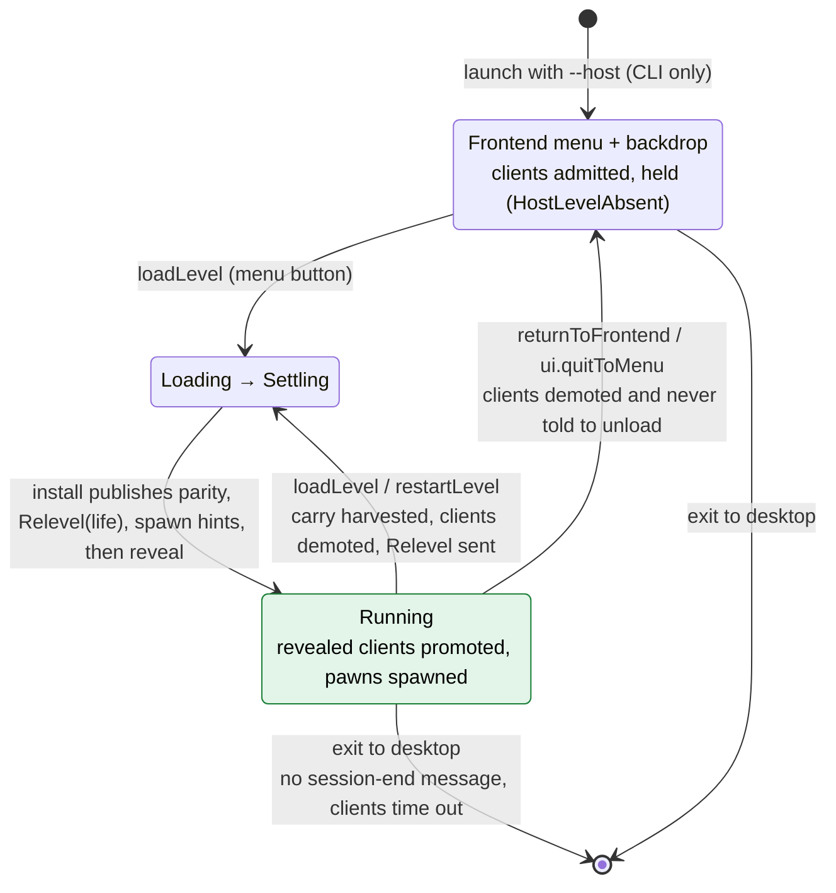
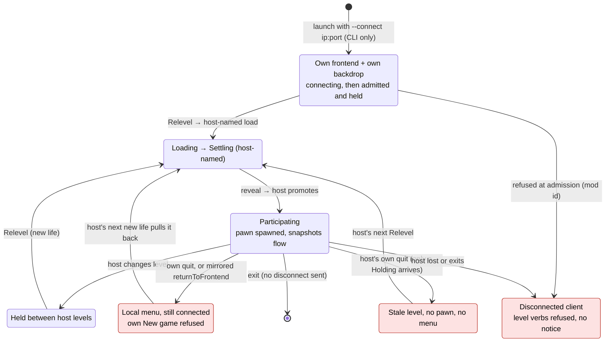
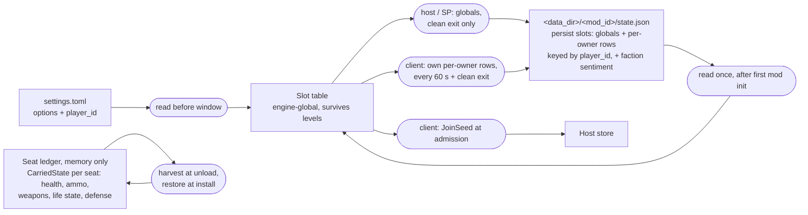
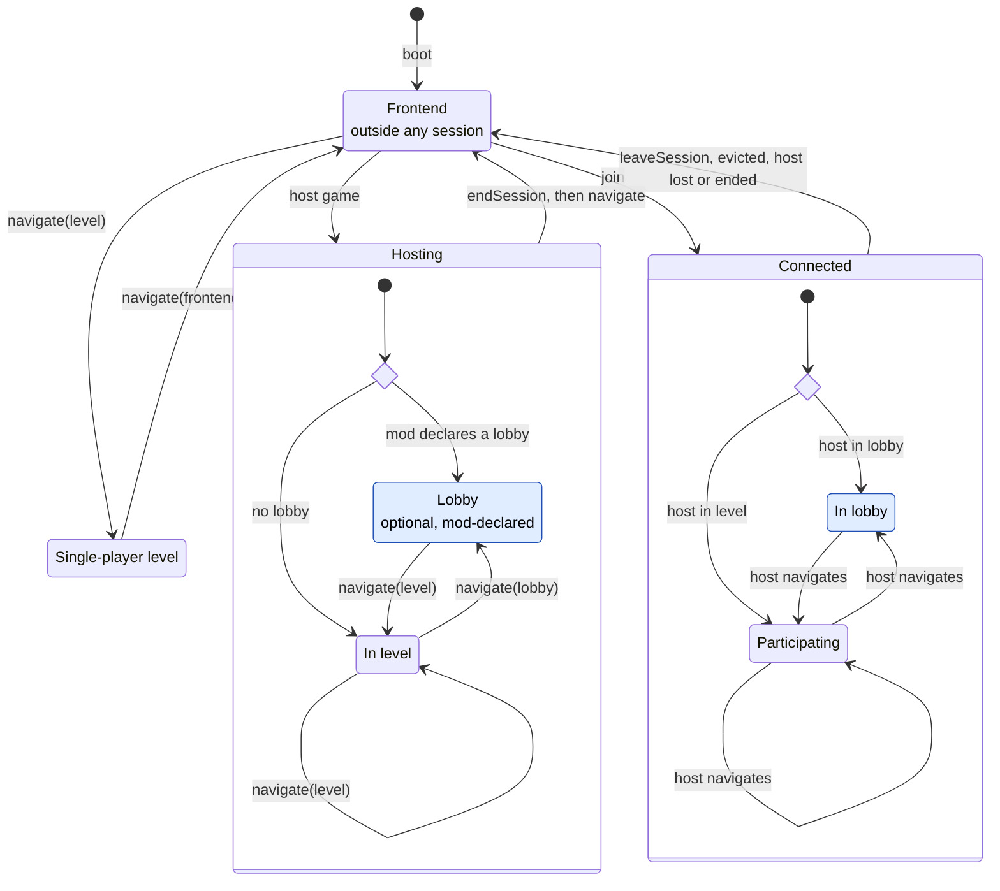
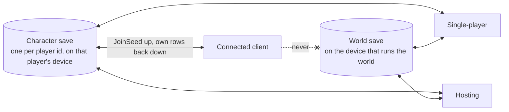
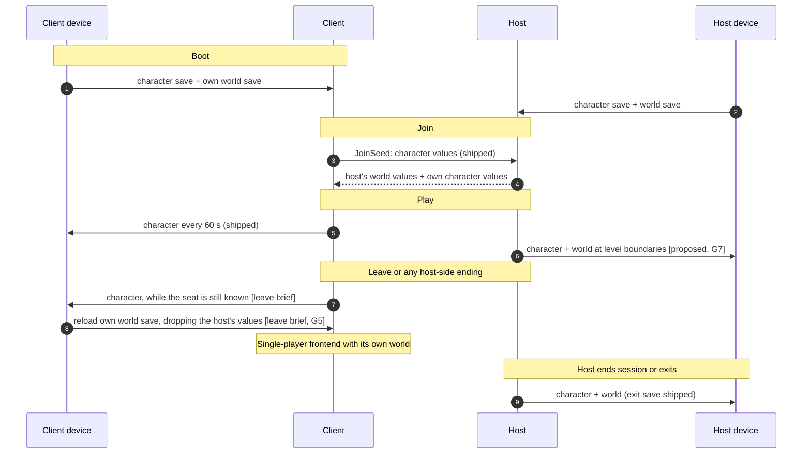

# Co-op Session Lifecycle — Today and Target

> **Read this when:** deciding brief boundaries for leaving, kicking, host-to-menu, in-app hosting or joining, and run saves. It maps a session's whole life, and where save data is read and written along it.
> **Status:** research. The "Today" sections are read from source at 3fba30ae. The "Target" sections are a proposal: each item is marked **decided**, **leaning** or **open**, and nothing here binds until a brief or `context/lib/` records it.
> **Related:** [Networking](../lib/networking.md) §Role model, §Slot lifecycle, §Session-state ledger · [Scripting](../lib/scripting.md) §5 (Durable State Store), §10.4 · [Player options](../lib/player_options.md) · [Co-op session and lobby](coop-session-lobby.md) · `plans/drafts/coop--client-leave-session` · `plans/done/E16--per-player-persistence`

---

## 1. Today: host

Role comes only from CLI flags. A host's frontend is already lobby-like: clients connect and are admitted, and they wait as held slots (`HostLevelAbsent`) until a level installs.

A client disconnect holds its seat for 30 s (`HOLD_WINDOW`), whether the client disconnected cleanly or timed out. Reclaim needs a fresh `--connect` with the same player id.

## 2. Today: client

Shaded states are dead ends: the player has to relaunch, or the state is not what anyone intended.

A connected client's `loadLevel` and `restartLevel` are always refused, including after its connection has ended.

## 3. Today: save data

Only two files reach disk. Health, inventory and life state cross level changes in memory only. Neither a run's position (current map, carried loadout) nor world state is saved anywhere.

Facts by symbol: `state_path`, `load_persisted_state`, `overlay_persisted_state`, `should_save_persisted_state` (gated on `is_connected_client`), `save_connected_client_per_owner_state`, `PER_OWNER_SAVE_INTERVAL`, `apply_join_seed`, `SeatTable`, `CarriedState` (not serializable), `harvest_bound_pawns`.

## 4. Gaps and hazards found

| # | What | Evidence |
|---|---|---|
| G1 | A client's quit keeps the connection, and the host's next new life pulls it back into play | `return_to_frontend` has no role branch; `follow_relevel_catalog` |
| G2 | Host's own quit to menu strands clients in a stale, pawnless level | `client_drain_control` on `Holding` only demotes |
| G3 | A lost host, an admission refusal, or a host exit leaves the client disconnected and still a client | `NetClient::update` only logs; `WorldLessPoll::Failed` acted on for host only |
| G4 | Exit to desktop sends no disconnect; the host waits out the timeout | no `NetClient` disconnect method |
| G5 | **Save leak on leave.** Once a client drops its endpoint, it saves globals at exit, and its slot table still holds the host's replicated values, so the host's world state would land in the ex-client's own `state.json` | `should_save_persisted_state(can_save, is_connected_client)` |
| G6 | No in-app host, join, leave or kick, and no player-facing connection state | reserved `ui.*` actions; `session.hosting` is display only |
| G7 | Globals save only at clean exit; a crash loses a whole session's progress | `scripting.md` §5 |
| G8 | No run save: a session cannot resume its map or loadouts later | `CarriedState` has no serde; `player_options.md` §1 "Game saves: TBD" |
| G10 | Character and world progress share one `state.json`: per-owner rows under the player id beside the global slots. Character progress already moves between single-player and co-op, because the single-player and host exit save writes the local player's rows and a joining client's `JoinSeed` reads the same rows. The two kinds of progress just have no separate home | `collect_per_owner_state`, `join_seed_from_persisted_state` |
| G9 | Stale docs: `coop-session-lobby.md` §3 and `research/netcode/index.md` non-goals deny client saves, but per-player persistence shipped | `done/E16--per-player-persistence` |

## 5. Target: navigation and membership are separate verbs

`returnToFrontend` mixes two jobs: **navigating** to a scene and **membership** in a session. The target gives each job its own verbs. Navigation never changes membership. The frontend is outside every session, so inside a session only a membership verb reaches it.

| Verb | Job | Single-player | Host | Connected client |
|---|---|---|---|---|
| `navigate(destination)` (working name) | navigation | any destination | session destinations only (the lobby, if declared, and levels), with clients following | dropped and warned: the host leads |
| `leaveSession()` | membership | no-op | warn: a host ends the session instead | close cleanly, then land at the declared frontend |
| `endSession()` | membership | no-op | close every slot and notify clients; stay where it is, now single-player | no-op: the host's copy ends it |
| `evictPlayer(player)` | membership | n/a | close that player's slot with a cause | lands at the frontend |
| `ui.quitToMenu` (engine action) | resolves by role | navigate to the frontend | `endSession()`, then frontend | `leaveSession()` |

**Decided (owner, this session):** `leaveSession`, `endSession` and `evictPlayer` are explicit membership verbs. Evicting and ending are host-executed closes, because the host owns admission. Navigation is one generalized function.

**Open, for the brief that ships it:** the navigation function's name and destination shape. Also whether `loadLevel` and `restartLevel` fold into it.

**Decided (owner, this session):** `endSession` only ends the session, and navigation is a separate step. A run's end composes them (`endSession()` then a navigation step), which runs in every role. A mod may declare more than one frontend; nothing assumes there is only one.

**Leaning:** navigating to a frontend inside a session is refused with a warning that names `leaveSession` / `endSession`.

## 6. Target: session lifecycle, with an optional lobby

A lobby is optional and mod-declared, the way a frontend is today. A one-map-one-run game declares one, and players gather there between runs. A game without one goes from level to level, and the session ends at the frontend.

- **Transitions:** clients follow the host's navigation; the ledger carries across level changes. A client's `leaveSession`, an eviction, a refusal, a lost host, and the host's `endSession` all land the client at a single-player frontend. Hosting and joining happen in-app.
- **Decided:** direct connect only (no discovery, relay or matchmaking); the engine owns admission, seats and map authority; the mod owns lobby policy (`coop-session-lobby.md` §2). The lobby is optional (owner, this session).
- **Decided (owner, this session): a host can protect its session with a password.** Admission checks it after the mod id. A wrong or missing password is refused like a mod-id mismatch and lands the client at its frontend with a notice.
  - **Leaning:** the password is an engine admission gate, not part of the mod's join predicate. A secret never enters a store slot, a replicated value, or a save.
  - **Leaning:** never send it in the clear. The transport runs netcode `Unsecure` (`NetServer` setup in `crates/net/src/transport.rs`), so admission uses challenge and response: the host sends a fresh nonce, and the client answers with a keyed hash of password and nonce. This gates access only; it is not identity authentication or anti-cheat, which stay non-goals (`coop-session-lobby.md` §6).
  - **Open:** where the host sets it (in-app hosting, a CLI flag for command-line hosts, or both), and whether the client may retry a wrong password without reconnecting.
- **Leaning:** session phase is a mod-declared slot. A lobby is a scene the host navigates to, not a new app state.
- **Open:** what a lobby declaration holds (menu tree, backdrop, whether players have pawns there), and whether a host can sit in a lobby with no level installed.

## 7. Target: character and world progress, saved separately

**Decided (owner, this session):** character progress and world progress are saved separately. A player can take one character from host to host without losing progress, and progress made in single-player carries into co-op and back.

| | Character save | World save |
|---|---|---|
| Holds | the mod's per-owner `persist` slots (XP, unlocks, stats), plus the carried loadout when the author chooses, keyed by player id | global `persist` slots and faction sentiment (shipped). Run state is **open**: current map, revisited maps, and carried loadouts the author keeps with the world |
| Lives | on the player's own device | on the device of whoever runs the world: the single-player machine, or the host |
| Written by | its owner only, in every role (shipped; a host never writes a guest's character) | the world's runner only. A connected client never writes one |
| Read | at boot, then sent up to any host in `JoinSeed` (shipped) | at boot. **Open:** a frontend "Continue" also reads run state |
| Today | rows inside `state.json` | the same `state.json` (G10) |

- **Proposed:** separate files, one per kind. A character file then has an obvious identity (player id and mod) and can be backed up or moved on its own. A world save can grow into save slots without touching characters.
- **Leaning (owner, this session): gear scope is the author's choice.** Players often want to bring gear from one game into another. A mod's parameters say whether the carried loadout (`CarriedState`: health, ammo, weapons, defense) travels with the character or stays with the world's run. Open: whether one switch covers the whole loadout or each part chooses, and how a host vets gear a joining character brings from another world (it must name weapons this host's mod defines, and it is client-asserted like all character progress).
- **Leaning:** a run save, the revisited-map record (`roadmap.md` Future) and a host-migration handoff (Epic 15) share one serialization of the session-state ledger, decided before any of them ships.

## 8. Proposed brief boundaries

| Order | Brief | Owns | Depends on |
|---|---|---|---|
| 1 | `coop--client-leave-session` (reshape) | `leaveSession()` and `endSession()`; `ui.quitToMenu` resolving by role; exit to desktop disconnecting; any host-side ending landing at a single-player frontend; on leave, saving the character and then reloading the player's own world; inside a session, `returnToFrontend` refused with a warning (G1–G5) | none |
| 2 | Optional lobby and navigation (new) | the mod-declared lobby; the generalized `navigate(destination)` that replaces `returnToFrontend`; clients following the host's navigation | leave |
| 3 | Phase 3.75 lobby authoring surface | in-app hosting, including setting a session password; session phase, join predicate, joined, left and phase-changed reactions, `evictPlayer` and its policy | optional lobby |
| 3 | In-app join (new, small) | direct-connect UI: address and password entry, connecting and refused states, notice on a host-side ending | leave |
| 3 | Session password (new, small) | the engine admission gate and its challenge and response, a refusal cause, and a CLI flag for command-line hosts and joiners | leave, for the refusal path |
| 4 | Character and world saves (new) | separate files, level-boundary world saves (G7), the author's gear-scope parameter, run state and Continue | none |

Ending a session with `endSession` closes G2 for games without a lobby, so brief 1 no longer leaves clients stranded. Brief 2 adds the stay-together path.
