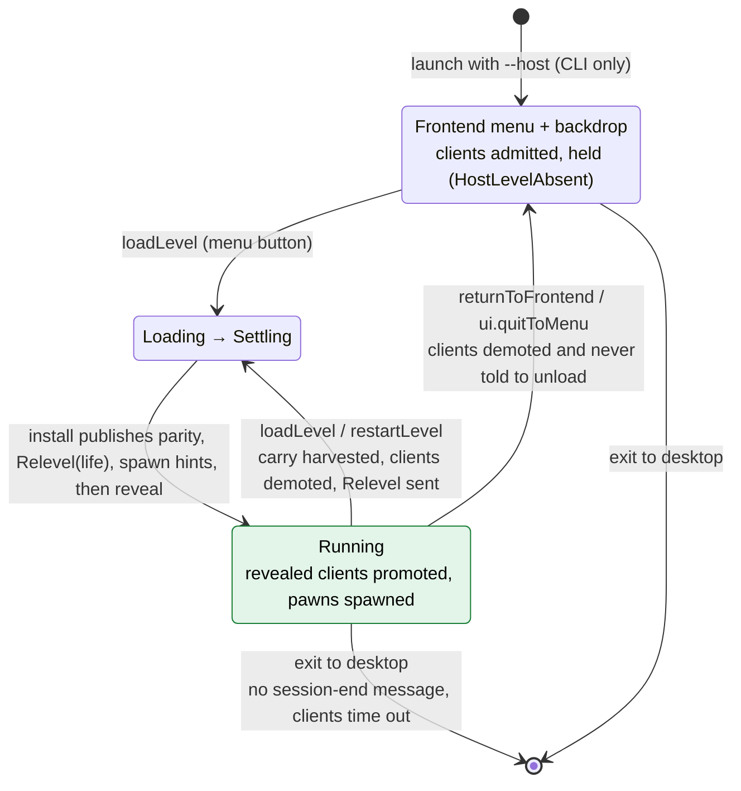
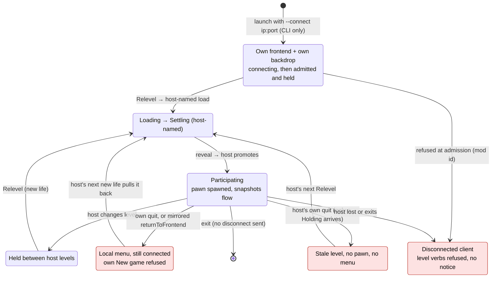
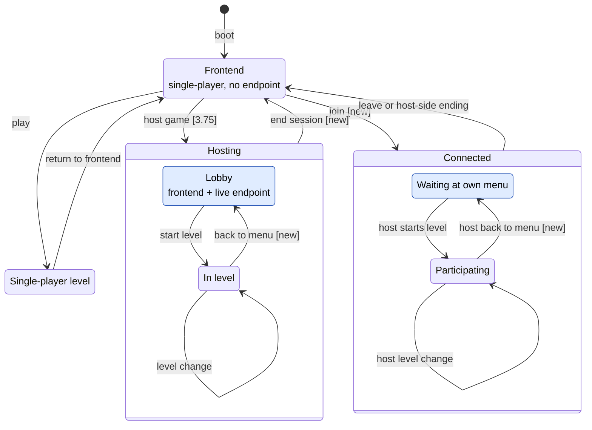
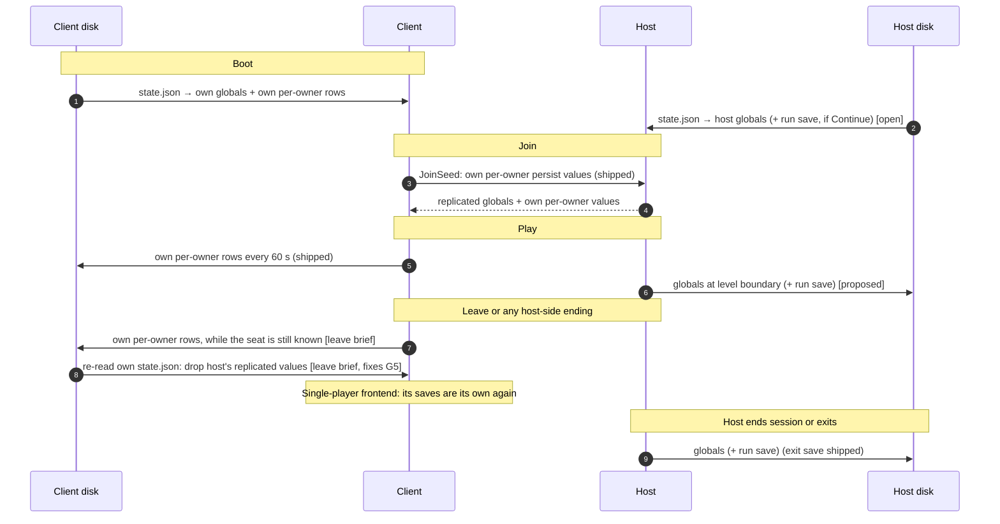

# Co-op Session Lifecycle — Today and Target

> **Read this when:** deciding brief boundaries for leaving, kicking, host-to-menu, in-app hosting or joining, and run saves. It maps a session's whole life, and where save data is read and written along it.
> **Status:** research. The "Today" sections are read from source at 3fba30ae. The "Target" sections are a proposal: each item is marked **decided**, **leaning** or **open**, and nothing here binds until a brief or `context/lib/` records it.
> **Related:** [Networking](../lib/networking.md) §Role model, §Slot lifecycle, §Session-state ledger · [Scripting](../lib/scripting.md) §5 (Durable State Store), §10.4 · [Player options](../lib/player_options.md) · [Co-op session and lobby](coop-session-lobby.md) · `plans/drafts/coop--client-leave-session` · `plans/done/E16--per-player-persistence`

---

## 1. Today: host

Role comes only from CLI flags. A host's frontend is already lobby-like: clients connect and are admitted, and they wait as held slots (`HostLevelAbsent`) until a level installs.

A client disconnect holds its seat for 30 s (`HOLD_WINDOW`), whether the client disconnected cleanly or timed out. Reclaim needs a fresh `--connect` with the same player id.

## 2. Today: client

Shaded states are dead ends: the player has to relaunch, or the state is not what anyone intended.

A connected client's `loadLevel` and `restartLevel` are always refused, including after its connection has ended.

## 3. Today: save data

Only two files reach disk. Health, inventory and life state cross level changes in memory only. Neither a run's position (current map, carried loadout) nor world state is saved anywhere.

Facts by symbol: `state_path`, `load_persisted_state`, `overlay_persisted_state`, `should_save_persisted_state` (gated on `is_connected_client`), `save_connected_client_per_owner_state`, `PER_OWNER_SAVE_INTERVAL`, `apply_join_seed`, `SeatTable`, `CarriedState` (not serializable), `harvest_bound_pawns`.

## 4. Gaps and hazards found

| # | What | Evidence |
|---|---|---|
| G1 | A client's quit keeps the connection, and the host's next new life pulls it back into play | `return_to_frontend` has no role branch; `follow_relevel_catalog` |
| G2 | Host's own quit to menu strands clients in a stale, pawnless level | `client_drain_control` on `Holding` only demotes |
| G3 | A lost host, an admission refusal, or a host exit leaves the client disconnected and still a client | `NetClient::update` only logs; `WorldLessPoll::Failed` acted on for host only |
| G4 | Exit to desktop sends no disconnect; the host waits out the timeout | no `NetClient` disconnect method |
| G5 | **Save leak on leave.** Once a client drops its endpoint, it saves globals at exit, and its slot table still holds the host's replicated values, so the host's world state would land in the ex-client's own `state.json` | `should_save_persisted_state(can_save, is_connected_client)` |
| G6 | No in-app host, join, leave or kick, and no player-facing connection state | reserved `ui.*` actions; `session.hosting` is display only |
| G7 | Globals save only at clean exit; a crash loses a whole session's progress | `scripting.md` §5 |
| G8 | No run save: a session cannot resume its map or loadouts later | `CarriedState` has no serde; `player_options.md` §1 "Game saves: TBD" |
| G9 | Stale docs: `coop-session-lobby.md` §3 and `research/netcode/index.md` non-goals deny client saves, but per-player persistence shipped | `done/E16--per-player-persistence` |

## 5. Target: verbs say intent

`returnToFrontend` mixes two jobs: **navigating** to the frontend scene and **membership** in a session. The target separates them, so no origin has to guess which one an author meant.

| Verb | Job | Host / single-player | Connected client |
|---|---|---|---|
| `returnToFrontend` | navigation | unload to menu (host: to the lobby, clients follow) | follow the host's lead; never ends the session |
| leave (new) | membership | n/a, or host ends the session | close cleanly → single-player frontend |
| `ui.quitToMenu` | both | return to the frontend (the host's open question: lobby or end) | leave, then frontend |
| kick (new, host) | membership | close a seat's slot with a cause | lands at single-player frontend |
| end session (new, host) | membership | close every slot, return to frontend | lands at single-player frontend |

Leaning: kick and end session are host-executed closes, because the host owns admission (owner, this session). Open: verb names and SDK shape, which are the owner's to design.

## 6. Target: session lifecycle

- **Transitions:** clients follow the host into a level by Relevel, and the ledger carries across level changes. "Back to menu" is a host-sent signal clients follow while staying connected (G2). "End session" notifies every client. "Leave or host-side ending" covers the player's own leave plus a lost host, a refusal, a kick and an ended session: all land at a single-player frontend through the leave brief. Hosting and joining happen in-app.
- **Decided:** direct connect only (no discovery, relay or matchmaking); the engine owns admission, seats and map authority; the mod owns lobby policy (`coop-session-lobby.md` §2).
- **Leaning:** a lobby is the frontend with a live endpoint, not a new app state; session phase is a mod-declared slot.
- **Open:** whether the host boots into a lobby by default or the mod opts in (`coop-session-lobby.md` §5). Also whether a host's quit-to-menu goes to the lobby or ends the session.

## 7. Target: save data across a session's life

- **Shipped:** per-player progression is portable across hosts. Each player's per-owner `persist` slots live on their own device and travel up in `JoinSeed`. A host's globals live on the host's device.
- **Leave brief owes (fixes G5):** before dropping the endpoint, save the client's own per-owner rows. Then restore the client's store from its own `state.json`, so the host's replicated values never reach the ex-client's saves or its single-player world.
- **Proposed, open (G7):** the host also saves globals at level boundaries and at session end, not only at process exit.
- **Open owner decision (G8): does a co-op run resume across sessions?**
  - *Progression only* (Vermintide-style; shipped today): players keep unlocks and stats, and each session starts from a map the host picks.
  - *Run save* (campaign-style): at each level boundary the host serializes the session-state ledger: current map, each seat's `CarriedState` keyed by player id, and globals. A frontend "Continue" hosts from it. Rejoining players rebind by player id through the existing reclaim path. One format could serve three consumers: a run save, the revisited-map record (`roadmap.md` Future), and a host-migration handoff (Epic 15), since each packages the same enumerable ledger. Leaning: one format, decided before any of the three ships.

## 8. Proposed brief boundaries

| Brief | Owns | Depends on |
|---|---|---|
| `coop--client-leave-session` (reshape) | leave verb; `ui.quitToMenu` / exit-to-desktop leave on a client; any host-side ending → single-player frontend; save-then-restore on leave (G1, G3, G4, G5) | none |
| Host returns to lobby (new) | host-sent "at frontend" signal; clients follow to their menu, connected; host end-session verb (G2) | leave (end-session lands clients through it) |
| Phase 3.75 lobby authoring surface | in-app host, session phase, join predicate, joined/left/phase reactions, kick verb and policy | host returns to lobby |
| In-app join (new, small) | direct-connect UI: address entry, connecting and refused states, notice on host-side ending | leave (for the role change back) |
| Run save (new; the open decision in §7) | ledger serialization, level-boundary host saves, Continue | the owner's progression-vs-run decision |
